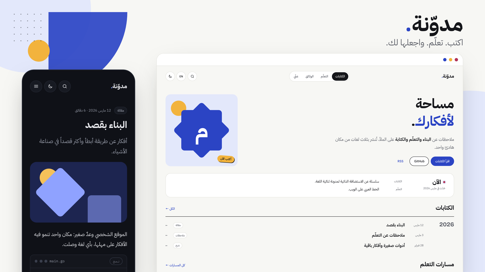

*معاينة توضيحية مولّدة من نظام تصميم التطبيق بمحتوى نموذجي.*

# مدوّنة (Modawana)

[المزايا](#المزايا) · [البدء السريع](#البدء-السريع) · [التوثيق](docs/README.ar.md) · [المساهمة](CONTRIBUTING.ar.md) · [English](README.md)

منصة ذاتية الاستضافة لكتاباتك وتوثيقك التقني ومساراتك التعليمية.
انشر مقالاتك بالعربية والإنجليزية والفرنسية، وخصّص موقعك بالكامل، وأدر كل شيء من لوحة تحكم خاصة ومحمية للمالك.

## المزايا

- تحرير سلس بصيغة Markdown مع معاينة حية ومباشرة، ورفع للصور ومقاطع الفيديو، وسجل مراجعات تاريخي ثابت غير قابل للتعديل.
- ترجمات مستقلة للمحتوى تخضع للمراجعة والتدقيق قبل النشر، مع دعم أصيل ومتكامل لاتجاه الكتابة العربي من اليمين إلى اليسار (RTL).
- تنظيم متقدم عبر التصنيفات، والوسوم، والبحث الشامل، ومجموعات التوثيق التقني، ومسارات التعلّم المرتبة والواضحة.
- اختبارات تقييمية تُصحّح برمجياً في جانب الخادم واشتراطات متطلبة لفتح الدروس، مع متابعة تقدم التعلم ضمن نطاق المتصفح.
- ملف شخصي قابل للتخصيص بالكامل، مع إمكانية ضبط الصفحة الرئيسية، ولوحة الألوان، والشعار، ونصوص الواجهة.
- تسجيل الدخول المريح والآمن عبر مفاتيح المرور (Passkeys)، مع بديل اختياري بكلمة المرور ورموز TOTP، ودعم العوامل الاحتياطية ورموز الاسترداد المحفوظة دون اتصال.
- أدوات استيراد وتصدير ونسخ احتياطي منسقة، وإمكانية النشر بصلاحيات محددة عبر واجهة السطر البرمجي (CLI) أو واجهة التطبيقات (API) أو تكامل بروتوكول سياق النموذج (MCP) الاختياري.

يقوم تطبيق Go مدمج واحد بخدمة واجهة React وواجهة البرمجة (API). تتولى قاعدة بيانات SQLite إدارة البيانات الوصفية، بينما تُحفظ مراجعات Markdown والوسائط المرفوعة على قرص تخزين دائم. تُعد بيئة Node.js مطلوبة لأغراض التطوير والبناء فقط، ولا حاجة إليها لتشغيل الخادم في بيئة الإنتاج. لا يتيح النظام التسجيل العام، ولا يحتوي على أي بيانات تجريبية مسبقة.

## البدء السريع

ثبّت كلاً من Go **1.27.3** وNode **22.23.4** وnpm **10.9.2** (وهي الإصدارات المعتمدة والمثبتة في المستودع)، ثم نفّذ الأوامر التالية:

```sh
git clone https://github.com/mbougarne/modawana.git
cd modawana
node scripts/project.mjs install
export BLOG_DATA_ROOT="$HOME/.local/share/personal-blog-dev"
node scripts/project.mjs dev
```

افتح الرابط [localhost:3000/ar](http://localhost:3000/ar)، أو استخدم المسار `/en` أو `/fr`.
ثم في نافذة طرفية أخرى ومن مجلد المشروع نفسه:

```sh
export BLOG_DATA_ROOT="$HOME/.local/share/personal-blog-dev"
node scripts/project.mjs bootstrap
```

افتح الرابط `/ar/login`، وأدخل تصريح الإعداد الأولي أحادي الاستخدام (setup grant) مع عنوان بريدك الإلكتروني في نموذج الإعداد المحلي/الاسترداد، ثم سجّل مفتاح مرور جديداً واستخدمه للدخول. احتفظ بالتصريح في مكان آمن وسري.
استخدم دائماً المضيف `localhost`؛ حيث يؤدي التبديل إلى `127.0.0.1` إلى تغيير أصل المصادقة (origin) في معيار WebAuthn.
راجع دليل [التطوير المحلي](docs/getting-started.ar.md) للاطلاع على متطلبات المتصفح، وإعداد اتصال HTTPS الموثوق، وإجراءات الاسترداد.

بعد تسجيل الدخول، انتقل إلى شاشة **المحتوى** لكتابة مقالك الأول؛ احفظه كمسودة وعاينه مباشرة ثم انشره. اضبط هويتك العامة ومعلوماتك من خلال **الملف الشخصي** و**الإعدادات**. يبدأ أي تثبيت جديد نظيفاً وخالياً تماماً؛ ويبقى بريد تسجيل الدخول الخاص بك منفصلاً كلياً عن ملفك التعريفي العام.

## الاستضافة الذاتية

يمكنك بناء التطبيق عبر الأمر `node scripts/project.mjs build` أو استخدام إعدادات Docker Compose المرفقة. اتبع [دليل النشر](docs/deployment.ar.md) لتهيئة اتصالات HTTPS، والمفاتيح الخاصة، والتخزين الدائم، وإعداد حساب المالك، والترقيات المستقبلية. شغّل مثيلاً واحداً فقط من التطبيق معتمداً على وحدة تخزين محلية.
واحرص على قراءة دليل [النسخ الاحتياطي والاستعادة](docs/operations/recovery.md) قبل البدء بنشر محتوى حقيقي على الخادم.

## التطوير

```sh
node scripts/project.mjs format
node scripts/project.mjs check --race
node scripts/project.mjs build
```

راجع دليل [المساهمة](CONTRIBUTING.ar.md) لمعرفة معايير الاختبارات وتنسيق الكود وتحزيم الإصدارات.
يغطي [فهرس التوثيق](docs/README.ar.md) موضوعات التحرير، والأمان، والتكاملات، والبنية المعمارية، ونظام التصميم.
كما يوضح دليل [جاهزية الإصدار](docs/release-readiness.ar.md) خطوات الفحص اليدوي التي لا تغطيها الاختبارات الآلية.

## الترخيص

يخضع هذا المشروع لترخيص [MIT](LICENSE). وتحتفظ الخطوط والمكتبات والتبعيات المضمنة [بإشعارات تراخيصها الأصلية](docs/licenses.md).
