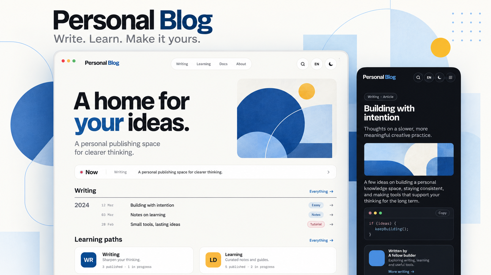

*Illustrative preview based on the application design; sample content.*

# Modawana

[Features](#features) · [Quick start](#quick-start) · [Documentation](docs/README.md) · [Contributing](CONTRIBUTING.md) · [العربية](README.ar.md)

A self-hosted home for your writing, documentation, and learning paths.
Publish in English, Arabic, and French, customize your site, and manage everything
from a private owner dashboard.

## Features

- Markdown editing with live preview, image/video uploads, and immutable revision history.
- Independent translations with review before publication; Arabic right-to-left layouts.
- Categories, tags, search, documentation collections, and ordered learning paths.
- Server-graded quizzes and lesson prerequisites, with browser-scoped learning progress.
- Configurable profile, home page, colours, logo, and interface labels.
- Passkey sign-in, optional password plus TOTP, backup factors, and recovery codes.
- Import/export, coordinated backups, and scoped publishing through a CLI, API, or optional MCP integration.

One Go application serves the React frontend and API. SQLite stores metadata;
Markdown revisions and uploads live on persistent disk. Node is needed for development
and builds, not to run the production server. There is no public signup or seeded content.

## Quick start

Install Go **1.27.3**, Node **22.23.4**, and npm **10.9.2** (the versions pinned in
this repository), then:

```sh
git clone https://github.com/mbougarne/modawana.git
cd modawana
node scripts/project.mjs install
export BLOG_DATA_ROOT="$HOME/.local/share/personal-blog-dev"
node scripts/project.mjs dev
```

Open [localhost:3000/en](http://localhost:3000/en), or use `/ar` or `/fr`.
In another terminal, from the same checkout:

```sh
export BLOG_DATA_ROOT="$HOME/.local/share/personal-blog-dev"
node scripts/project.mjs bootstrap
```

Open `/en/login`, enter the one-use setup grant with your email in the local
setup/recovery form, register a passkey, then sign in. Keep the grant private.
Use `localhost` consistently; changing to `127.0.0.1` changes the WebAuthn origin.
For browser requirements, trusted HTTPS, and recovery, see [local development](docs/getting-started.md).

After signing in, open **Content** to write your first post. Save a draft, preview it,
then publish. Set your public identity in **Profile** and **Settings**. A new
installation starts empty; your private login email is separate from your public profile.

## Self-hosting

Build with `node scripts/project.mjs build`, or use the supplied Docker Compose
configuration. Follow the [deployment guide](docs/deployment.md) for HTTPS, private
keys, persistent storage, owner setup, and upgrades. Run one application instance
on local storage. Read [backup and recovery](docs/operations/recovery.md) before
putting real content on the server.

## Development

```sh
node scripts/project.mjs format
node scripts/project.mjs check --race
node scripts/project.mjs build
```

See [Contributing](CONTRIBUTING.md) for tests, code style, and release packaging.
The [documentation index](docs/README.md) covers writing, security, integrations,
architecture, and design. [Release checks](docs/release-readiness.md) describe
manual verification that automated tests cannot establish.

## License

[MIT](LICENSE). Bundled fonts and dependencies retain their own
[license notices](docs/licenses.md).
