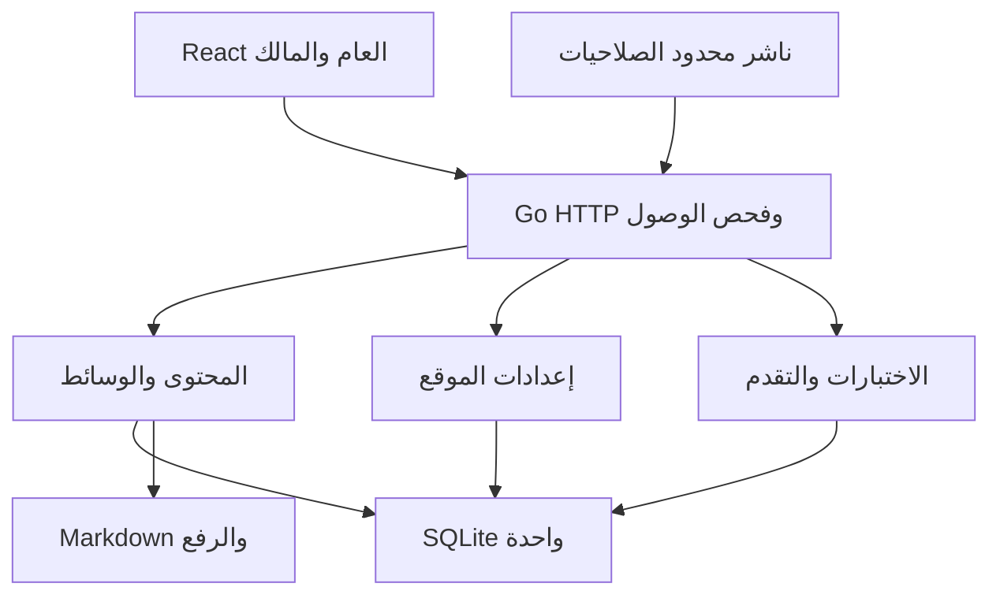

# عقود الإعدادات والتعلّم

[English](architecture-appendix-configurable-learning.md) · [البنية](architecture.ar.md)

قيود مفصلة للإعدادات والوصول إلى التعلم والمصادقة والتخزين الدائم.

## 1. تطبيق واحد بمسؤوليات واضحة

الحزم داخل عملية Go نفسها، ومسارات `internal/` أدناه داخل `backend/`.

| الجزء | Go | React |
| --- | --- | --- |
| `internal/auth` | إعداد المالك وpasskeys/TOTP والجلسات وCSRF والحدود والنطاقات | الدخول وإجراء WebAuthn بالمتصفح والعوامل والأمان والجلسات |
| `internal/siteconfig` | الإعدادات والملف والنصوص والتحقق والتطبيق والتاريخ والإسقاط العام الآمن | النماذج والمعاينات بقيم التصميم |
| `internal/content` | مراجعات Markdown واللغة والنشر والتصنيف والمجموعات | القراءة والمحرر ومقارنة المراجعات والنشر |
| `internal/learning` | التعريف والتصحيح والبوابات والتقدم المجهول والوصول | منشئ/عارض الاختبار والقفل والمخطط والتقدم والإعادة |
| `internal/media` والتخزين | رفع دائم وحدود الغرض والقراءة المضبوطة والمراجع | طابور الرفع والاختيار والمعاينة والبدائل والترجمة والمكتبة |
| `internal/http` والقاعدة | التوجيه والمخططات والقالب والمعاملات | عميل API مضبوط الأنواع والتخطيط والتحميل والأخطاء وحالة النماذج |

المعالجات والناشر يستخدمان الخدمات نفسها؛ Go وحده يقرأ الملفات والقاعدة. لا تربط المجال بمكون أو علامة تجارية. تشترك المسارات العامة والإدارية في العرض ويمكن تحميل حزمة الإدارة كسولاً؛ الحزم ليست تفويضاً.

خدمة الوصول مشتركة لحل الصفحات وAPI المحتوى وGET/HEAD/Range للوسائط والاختبارات والخلاصات والبحث؛ لا مسار ثانٍ يتجاوز البوابة.

## 2. الإعدادات والحفظ واللغات

### 2.1 ثلاثة أنواع منفصلة

| النوع | مكانه | أمثلة |
| --- | --- | --- |
| المشغل | بيئة التشغيل أو ملفات سرية/إعداد مثبتة | base URL والوكلاء ومسار البيانات وRP ID/origins ومفتاح التشفير وحدود الرفع والنسخ |
| العام القابل لتحرير المالك | سجلات SQLite بإصدارات ووسائط كملفات | الألوان والشعار والاسم والصورة والغلاف والخبرات والروابط وNow والنصوص والأيقونات |
| تفضيل القارئ | المتصفح والتقدم له سجل خادم أيضاً | فاتح/داكن/النظام واللغة وملف تقدم مبهم |

لا أسرار مشغل في الحمولة العامة أو البناء أو تصدير الإعدادات أو السجلات أو style. تعديل الهوية لا يحتاج بناء Webpack أو إعادة تشغيل أو تعديل ملف القيم المصدر.

### 2.2 الهوية والألوان

خزّن `logo_mode` من `wordmark` و`monogram` و`image`، ونصاً محدوداً وmonogram من 1–3 عناقيد حروف، ومعرّفات الشعار وfavicon الاختيارية وأيقونات القائمة ولوني hex. الصورة الشخصية منفصلة لتجتمع مع wordmark. غياب الصورة يستعمل monogram وغياب شعار الصورة يستعمل النص/monogram. أداة هوية واحدة في الترويسة؛ صورة مؤلف المقال ليست قائمة ترويسة ثانية.

الشعار/favicon: PNG/JPEG/WebP متحقق ≤1 MiB. الصورة: الأنواع نفسها ≤2 MiB مربعة و≥600×600. الغلاف الاختياري صورة نقطية ضمن 10 MiB العادي مع بديل محلي وموضع قص/تركيز. ارفض عدد البكسلات المفرط والحجم الزائد. أعد تحقق الغرض عند الإشارة إلى media ID قائم. لا CSS أو خطوط أو JavaScript أو SVG مرفوعة.

`design-system/tokens.json` مصدر الافتراضيات المشحونة؛ ولّد `tokens.css` بـ`node design-system/scripts/build-tokens.mjs` ولا تعدله. تتجاوز ألوان التثبيت فقط `majorelle*` و`on-majorelle` و`sun` و`on-sun` والظلال التابعة المسموحة؛ المحايد والحالة والمسافات والخطوط تحت الكود.

اتبع BRAND بخوارزمية حتمية مرقمة ومتجهات اختبار Go/TypeScript مشتركة. تحقق من `#RRGGBB` واشتق درجات الوضعين والنصوص وافحص الأزواج الفعلية على paper وsurface والخفيف وتعبئة اللونين وحدود التركيز. الحد 4.5:1 للنص العادي و3:1 للكبير/حدود الأدوات المنطبقة. وضّح تعديل الدرجات بالمعاينة وامنع التطبيق إن فشل زوج مطلوب؛ لا تثق بنسبة العميل. يصدر Go قيماً رقمية/hex متحققاً منها بقالب البداية مع CSP nonce وبرنامج مظهر مسموح عند الحاجة لمنع الوميض، لا CSS اعتباطي من المالك. تتضمن الاستجابة العامة نسخة الخوارزمية والقيم الفعلية، والمعاينة العقد نفسه. يبقى اختيار المظهر للقارئ.

### 2.3 الملف والغلاف والخبرة

| المجموعة | البيانات والتحقق |
| --- | --- |
| الهوية والترويسة | اسم وعنوان محليان مع أسطر وتأكيد محدود، وسيرة ≤320 حرف Unicode، وملصق اختياري وبدائل الصورة/الغلاف المحلية |
| أفعال الترويسة | فعل رئيسي وحتى 10 روابط مرتبة بمعرّفات ثابتة وتسميات محلية وعنوان وأيقونة مسموحة وظهور؛ GitHub/LinkedIn اختياريان لا تخمين |
| Now | حتى 3 صفوف ثابتة، لكل تسمية ونص محلي ≤160 حرفاً؛ `updated_month` بصيغة `YYYY-MM` يعرض محلياً؛ إخفاء الفارغ |
| الخبرة | حتى 20 مدخلاً مرتباً: معرّف ثابت ودور/منظمة/وصف محلي، شهر-سنة البداية والنهاية وعلامة الحالي وURL اختياري متحقق |
| About | ملف منظم قصير؛ السرد الأطول يشير إلى `doc` محلي بجسم Markdown ومراجعاته |
| التواصل/التذييل | بريد عام وموقع اختياري واسم عرض/حقوق وروابط ودعوة محلية؛ بريد الدخول خاص ومنفصل |
| تركيب الرئيسية | أقسام Version B ثابتة، مع ظهور اختياري للغلاف وNow والكتابات والتعلم وأعداد محدودة؛ ليس منشئ صفحات حرّاً |

التأكيد والعريض قواعد تنسيق صغيرة خاملة في نص منظم محدود لا HTML تنفيذي. السرد الأطول ملفات Markdown. الروابط `https:` و`mailto:` مقيد ومسارات محلية مطلقة؛ ارفض protocol-relative وبيانات الاعتماد بالموقع والمخططات الخطرة والمحارف التحكمية. لا تجلب أهداف الروابط أو صوراً بعيدة عشوائياً من الخادم. وثيقة About لا تُستخدم عامة إلا منشورة باللغة المعروضة؛ يمكن استبعاد دورها التحريري من الأرشيف دون تجاوز الوصول. اخفِ الخبرة والتواصل الفارغين؛ الغلاف معطل افتراضياً ولا يحجب النص.

### 2.4 النصوص ليست ترجمة المقالات

لكل مفتاح يملكه الكود قسم وقيم EN/FR/AR افتراضية وplaceholders مسموحة ووصف استخدام. **كل** نص واجهة مرئي، بما فيه الأسماء الميسرة والأخطاء والفراغ ونتائج الاختبار والإدارة، يُحل بالسجل. يعيد Go أكواد أخطاء ومعاملات محددة الأنواع ولا يعتمد منطق العمل على صياغة قابلة للتعديل.

تضاف التجاوزات فوق القيم المشحونة. تجاوز FR/AR الفارغ صراحة يرجع إلى الإنجليزية الفعلية ويحسب ناقصاً؛ Reset يعيد القيمة المشحونة للغة. بلا تجاوز استخدم افتراضي اللغة ثم الإنجليزية. الإنجليزية الأساسية لا تكون فارغة والمفتاح المخصص يحتاج إنجليزية. علّم النص البديل بلغته واتجاهه الحقيقيين حين يضمّن بلغة أخرى.

المفاتيح محدودة على نمط `section.name` بأحرف صغيرة ونقاط/واصلات؛ لا إعادة تسمية أو حذف للمفاتيح الأساسية من اللوحة. المفتاح المخصص نص لموضع مدعوم أو كود لاحق، لا مسار أو أداة جديدة. اهرب النص وارفض HTML والمتغيرات المجهولة. يعلن السجل صيغ الجمع ومعاملات الاستيفاء بأنواعها ويختار الجمع محلياً بما فيه العربية لا تجميع شظايا إنجليزية؛ احفظ مجموعة المتغيرات المطلوبة في الترجمة والاستيراد.

البحث ومرشح القسم والنقص وعدّه وreset وتصدير/استيراد JSON للمالك تستخدم حزمة واحدة مرقمة؛ تحقق من المخطط وعدد/طول المفاتيح قبل الحفظ. لا تنفيذ كود أو تثبيت اعتماديات من النص. يجوز fallback المرئي للملف والنصوص فقط؛ **المقالات والدروس والوثائق والاختبارات لا تصبح إنجليزية تحت هوية عربية أو فرنسية**. قدم رابط لغة متاحة صريحاً. اللغة لا تغير التفويض والتقدم. EN/FR باتجاه LTR وAR باتجاه RTL مع عزل الكود. الفرنسية لغة إنتاج كاملة رغم غياب مفتاح شامل في النموذج.

### 2.5 المعاينة والمراجعة والتطبيق والتاريخ

لكل Settings وProfile وLabels مستند بإصدارات مستقل. تعدل الواجهة نسخة عمل محلية؛ Preview وCancel لا يغيران العام. Save and apply يرسل لقطة و`expected_version`؛ يفحص Go الحقول والوسائط ويحفظ مراجعة ثابتة ويحرك المؤشر في معاملة واحدة. 409 يبقي النموذج غير المحفوظ. لا خطوة نشر إعدادات خفية.

تطبيق تغييرات النصوص/الملف المترجمة يتضمن تأكيد مراجعة صريحاً للقيم؛ يسجل الخادم اللقطة وبصمة المصدر واللغة والمراجع. تبقى القيم المراجعة القديمة عامة حتى إكمال الجديدة. الأتمتة تستورد ترجمات المقالات كمسودات عبر API المحتوى ولا تطبق إعدادات الموقع. يمكن للمالك استيراد ترجمات ملف/نصوص إلى نسخة عمل ثم مراجعتها وتطبيقها؛ هذه مراجعة منتج لا إعادة اعتماد التصميم.

الاستعادة تنسخ لقطة قديمة إلى مراجعة عمل جديدة وتطبيقها صريح. لا حذف لوسائط اللقطات المحفوظة. القراءة العامة للمطبق وإسقاطه الآمن فقط. أبطل استعلامات React بعد النجاح؛ الطلبات الجديدة ترى التغيير ولا حاجة لخدمة تحديث بين التبويبات.

## 3. هوية التعلم والاختبارات والدروس المقفلة

### 3.1 التقدم دون تسجيل

تنشأ هوية تعلم مجهولة فقط عند بدء مسار أو إرسال اختبار. يصدر Go رمزاً عشوائياً تشفيرياً مبهماً في ملف `__Host-learning` منفصل Secure وHttpOnly وSameSite=Lax؛ تحفظ SQLite تجزئته والهوية والانتهاء والتقدم. **لا صلاحيات مالك**. تغييرات التقدم بالكوكي تحتاج origin/CSRF أيضاً.

أخبر القارئ أن التقدم محفوظ في هذا المتصفح. مسح الكوكي أو تبديل الجهاز يفقد الوصول؛ لا بريد أو حساب أو بصمة جهاز أو مزامنة أو استرداد ضمني. وفر Reset learning progress بتأكيد واضح يبطل الرمز ويحذف تقدمه. الاحتفاظ الأولي بعد الخمول 180 يوماً، يعدله المشغل ويوثقه إشعار الخصوصية؛ الانتهاء يعيد الوصول إلى الدروس الأولى. معاينة المالك وضع مستقل لا ينشئ نجاحات؛ يمكنه التدفق العادي للاختبار. حسابات عابرة للأجهزة امتداد صريح منفصل غير لازم أولاً.

### 3.2 البيانات والتصحيح

يمكن للمقال أو الدرس اختبار؛ درس المسار المرتب وحده يجعل النجاح متطلباً. المحرر والعارض مشتركان. بيانات تقييم منظمة محدودة في SQLite لا جسم مقال ثانٍ؛ تصدر في frontmatter متحقق أو ملف مرافق، والأجسام والرفع ملفات عادية.

- 1–20 سؤالاً أولاً: واحد أو متعدد أو صحيح/خطأ؛ للاختيارات 2–8 خيارات. نص السؤال والخيارات ومعرّفات ثابتة فريدة لازمة؛ صحيح واحد للواحد/صحيح-خطأ وواحد على الأقل للمتعدد؛ صحيح/خطأ خياران دلاليان ثابتان بالضبط.
- نقطة لكل سؤال. المتعدد صحيح فقط عند مطابقة مجموعة الاختيارات لمجموعة الإجابات تماماً، بلا نقاط جزئية. درجة النجاح عدد صحيح من 1 إلى عدد الأسئلة.
- النص والخيارات والشرح نص محلي عادي محدود. الإجابات IDs لا التسميات أو مواضع المصفوفة؛ ارفض النقص والتكرار والمجهول والشكل الخاطئ قبل التصحيح.
- الإعادة غير محدودة؛ حدود المعدل لحماية الخدمة لا سقف عمري. الشرح اختياري لكن النتيجة وحكم كل سؤال متاحان بعد إرسال كامل.
- العام يحذف المفاتيح والشروح الكاشفة قبل الإرسال؛ يمكن إعادتها بعد التصحيح وفق التدريس. هذه ممارسة لا امتحانات مراقبة أو شهادات، ولا يمكن منع مشاركة الحلول.

طلب المحاولة يتضمن نسخة الاختبار ومراجعة المحتوى ونسخة المسار والإجابات وidempotency key. يفحص Go الهوية والنشر والمتطلبات والنسخ ويصحح بالمفتاح المخزن ثم يدخل المحاولة والإكمال في معاملة قصيرة واحدة. يعيد النتيجة ودرجة النجاح والتغذية الراجعة والإكمال والفعل التالي المتاح. لا يثق بـ`passed` أو `unlocked` من العميل. تكرار الطلب نفسه يعيد النتيجة؛ حمولة أخرى بنفس المفتاح تعارض. النسخة القديمة ترجع 409 مع إعادة تحميل لا تصحيحاً بأسئلة جديدة لم تُرَ.

### 3.3 النشر والترجمة والنسخ

تشير المسودة لتعريف/نسخة اختبار ثابتة ونص أسئلة محلي. نشر المراجعة ينشر ارتباط اختبارها؛ الحفظ لا يغير الحي. معاينة المالك تصحح المسودة المحفوظة بنقطة خاصة دون محاولات أو تقدم. IDs الأسئلة والخيارات ومفاتيح التصحيح ودرجة النجاح تعريف تقييم واحد عبر اللغات. الترجمة صياغة ومراجعة لتلك النسخة ولا تغير الحل أو تخفض الحد.

قد يبقي نشر تقييم جديد ترجمات مقالات قديمة، لكن اختباراتها القديمة لا تمنح نجاحات جديدة؛ اعرض رابطاً صريحاً للغة اختبار حالية حتى نشر المراجع. تحرير النص فقط يمكن أن يعيد استعمال التقييم. يحتاج التقييم المستخدم ببوابة مراجعة مالك للنسخة الدقيقة قبل التفعيل؛ لا يستبدل النشر الآلي تقييماً بآخر غير مراجع ولو لم تتغير الدرجة.

النجاحات المكتسبة تبقى افتراضياً بعد التصحيح أو الترتيب، مع حفظ نسخة التقييم دليلاً. `progress_epoch` للمسار يبدأ 1. Reset path progress مستقل يرفع epoch بعد إظهار الأثر إن أراد المالك إعادة المادة للجميع؛ لا تعديل عادي أو رمز نشر يمسح الإنجازات خفية.

### 3.4 قواعد الترتيب

المسار قائمة بسيطة لا رسم تبعيات اعتباطي. خيار فتح التالي يعدل بوابة مسودة في خطة نشر المسار، وتتطلب اختباراً منشوراً صالحاً بالدرس المصدر. نشر الدرس والقاعدة المطابقة يفحص النسختين المتوقعـتين ويلتزمهما معاً. يرث الدرس التالي المستقبلي تلك البوابة.

لفتح N يلزم اجتياز **كل** بوابات الحدود السابقة للقارئ وepoch الحالي، فلا يتجاوز N+1 بوابة لأن N بلا اختبار. الحد بلا اختبار لا يضيف شرطاً. تشير البوابات إلى IDs دروس ثابتة لا URL أو الموضع وحده. قواعد وإنجازات واحدة لكل اللغات.

| الحالة | العام | ما يغيرها |
| --- | --- | --- |
| Open | الجسم المنشور والوسائط المسموحة والاختبار إن وجد | نشر موجود واجتياز البوابات السابقة |
| Locked | عنوان/ملخص منشور ومقتطف صريح اختياري وسبب وأول شرط ناقص، بلا جسم | نجاح مطلوب أو إزالة المالك للبوابة صراحة |
| Soon | عنوان/موضع خارطة طريق منشور اختيارياً، لا رابط/جسم | نشر اللغة؛ وقد يبقى Locked |
| Hidden | لا مدخل أو عنوان أو عدّ أو مسار | إعلان صريح أو نشر |

الإكمال غير الوصول: درس الاختبار بالنجاح، وغيره Mark as read عندما يكون الجسم مفتوحاً فقط. فتح/تمرير الصفحة ليس فهماً. «3 من 6 مكتملة» من سجلات الإكمال، و«4 منشورة» إحصاء مستقل. إلغاء نشر شرط لا يفتح ما بعده؛ النجاح السابق يبقى، والجديد يرى شرطاً غير متاح ورابط لغة إن أمكن. يرى المالك أثر التغيير قبل تطبيقه. إعادة الترتيب تمنع التبعية الذاتية والمواضع الخاطئة والمصدر الذي لا يسبق أهدافه وتعرض الدروس المتأثرة قبل الالتزام. لا حذف لاختبار مرجعي ببوابة حية حتى إزالة/استبدال البوابة صراحة. لا استرجاع لما نزل مسبقاً لجهاز القارئ.

### 3.5 كل مسارات التسليم

API المحتوى يرجع 403 `lesson_locked` ومقتطفاً آمناً للدرس المنشور غير المستوفى. HTML يعيد شاشة القفل بالحالة نفسها وبيانات آمنة و`noindex`؛ المفقود/غير المنشور 404، والمتاح 200. بيانات خارطة الطريق مستقلة عن استجابة غير المنشور.

لا جسم كامل في DOM أو JSON أو source map أو معاينة مخفية أو بحث أو RSS أو بيانات اجتماعية أو prefetch أو تصدير. استبعد صفحات الأجسام المقيدة من sitemap الأول؛ الخلاصات والبحث قد يربطان الملخصات بعلامة قفل. لا prefetch صامت للتالي المحمي. لا API عام للمفاتيح أو التاريخ الخاص.

الوسائط: وصول المالك، أو مرجع عام من الملف/المقتطف، أو مرجع واحد على الأقل من محتوى منشور يستطيع القارئ قراءته. طبقه على الصورة والفيديو GET/HEAD/Range والترجمات والملصقات والنصوص والتنزيلات. ملف معاد استخدامه بمقال مفتوح يصبح عاماً منه؛ أظهر استخدامه بالمكتبة كي لا يُظن خاصاً. الملف الخاص بالدروس المقيدة وحدها محمي ولو عُرف ID. لا static alias من الوكيل لمجلد الرفع.

`Cache-Control: no-store` للمحتوى الشخصي والتقدم والمحاولات والمصادقة والوسائط المضبوطة. حد الأحجام والإرسالات وإنشاء الهويات؛ احفظ الحد الأدنى وأنهِ خمول الهويات والمحاولات. اقتراح أولي 10 إرسالات/دقيقة للهوية مع سقف IP إضافي يضبط للشبكات المشتركة. دوّر/حد سجلات الإساءة والتدقيق لمنع نمو SQLite بلا حد.

## 4. مصادقة المالك والاسترداد

### 4.1 الدخول المفضل

**WebAuthn passkeys مع user verification مطلوب**. يفتح PIN/القياس الحيوي المفتاح محلياً؛ يتلقى الخادم تحدياً موقعاً لا بيانات حيوية. يربط WebAuthn الدخول بـRP وorigin خلاف OTP المكتوب؛ [W3C](https://www.w3.org/TR/webauthn-3/) و[OWASP MFA](https://cheatsheetseries.owasp.org/cheatsheets/Multifactor_Authentication_Cheat_Sheet.html).

كلمة المرور **مع**TOTP بديل توافق اختياري لا يُفعّل إلا بعد تسجيل كامل، أقوى من كلمة المرور وحدها لكنه ليس مقاوماً للتصيد. يبقى معطلاً في passkey-only. لا SMS أو رموز بريد كافتراضي، ولا حاجة لمزود بريد للاستضافة الذاتية.

### 4.2 الإعداد ودورة الاعتماد

مالك واحد بأمر محلي لا تسجيل عام. الإعداد منحة قصيرة أحادية الاستعمال وجلسة تسجيل مقيدة؛ أدخل المنحة بنموذج لا URL ولا سجلات أو صورة الحاوية. لا لوحة حتى passkey موثق أو كلمة مرور وTOTP متحقق. عطّل bootstrap بعد الاكتمال؛ الإعداد الناقص يغلق الوصول العام المخصص للمالك بأمان.

اعرض مفتاحاً ثانياً/مفتاح أمان وعشرة رموز استرداد عالية العشوائية، ≥128 بت عشوائي لكل منها، تعرض مرة للتخزين دون اتصال؛ `ABCD-1234` التجريبي ليس الصيغة الحقيقية. خزّن التجزئات واستهلكها ذرياً لمنع استعمال متزامن.

في password/TOTP يستبدل الرمز العامل الثاني بعد كلمة المرور. في passkey-only يمنح إعادة تسجيل قصيرة مقيدة لا نشر. بعد الاستبدال أبطل جلسات المالك واطلب دخولاً كاملاً جديداً؛ أبرز الحدث بالتدقيق. عند فقد الجميع يستخدم مشغل VPS أمراً محلياً يبطل التحديات والجلسات ويبدأ التسجيل المقيد ويسجل العملية؛ لا نقطة عامة لتعطيل MFA.

خارج bootstrap/recovery يلزم توثيق كامل حديث لإضافة/إزالة عامل وتغيير كلمة المرور/بريد الدخول وتجديد رموز الاسترداد وإنشاء رموز النشر أو إعادة المصادقة؛ حد الحداثة الأولي خمس دقائق. امنع حذف آخر وسيلة صالحة. التعطيل/الاسترداد يبطل الجلسات المعنية وتبديل OTP يبطل السر القديم. أظهر أسماء الأجهزة وأوقات الإنشاء/الاستخدام والإلغاء بلا أسرار. تنبيه البريد المستقبلي لا يصبح سلطة استرداد.

### 4.3 حماية الخادم والجلسات

استخدم تطبيقات Go مصانة لـWebAuthn وTOTP وتجزئة كلمات المرور، ولا تكتب تشفيراً. تُختار الإصدارات وتفحص عند التنفيذ مستقلة عن القديم.

| الشأن | المطلوب |
| --- | --- |
| WebAuthn | discoverable credentials بلا كتابة اسم حساب، ومعرف مالك مبهم؛ تحقق التحدي ونوع الإجراء وorigin/RP ID الدقيق والتوقيع وربط الاعتماد بالمالك والحضور والتحقق. تحديات أحادية بخمس دقائق مرتبطة بالغرض/الجلسة. ID ومفتاح عام وعدّاد/نسخ احتياطي تديره المكتبة. user verification بالتسجيل والدخول، وقواعد المكتبة لعدادات المتزامن |
| كلمات المرور | Argon2id مملح بمعاملات مرقمة مقاسة للـVPS؛ لا نص صريح أو تشفير كبديل للتجزئة أو اقتطاع أو تجزئة مبتكرة؛ [OWASP](https://cheatsheetseries.owasp.org/cheatsheets/Password_Storage_Cheat_Sheet.html) |
| TOTP | 6 أرقام وخطوات 30 ثانية وتسامح ساعة صغير موثق؛ رفض ذري لخطوة مقبولة مسبقاً؛ انتظار كلمة المرور بلا صلاحيات وينتهي بخمس دقائق |
| سر OTP | تشفير موثق بمفتاح مشغل خارج SQLite؛ التجزئة لا تتحقق من رموز مستقبلية. QR/السر بالتسجيل فقط مع no-store وبلا سجلات؛ نسخ المفتاح منفصلاً بأمان |
| الحدود | حسب الحساب وIP موثوق لكلمة المرور وTOTP وإتمام passkey والإعداد والاسترداد. خمس إخفاقات توقف محدود 15 دقيقة أولاً؛ أخطاء متكافئة للمجهول/الخاطئ. حدود تدريجية/IP قبل قفل المالك الشامل لتقليل حجب الخدمة؛ تغيير التحدي لا يصفر العدادات |
| الجلسة | عشوائية مبهمة على الخادم وتجزيء الرمز في SQLite؛ `__Host-owner` مع Secure وHttpOnly وSameSite=Strict وPath=/ وبلا Domain. تدوير عند الدخول؛ خمول 30 دقيقة وعمر مطلق 12 ساعة أولاً. لا JWT/رمز ناشر في localStorage |
| كتابات المتصفح | CSRF وorigin بما فيه الخروج والعوامل والإعدادات؛ لا تغيير بـGET، وSameSite وحده غير كاف؛ [OWASP](https://cheatsheetseries.owasp.org/cheatsheets/Session_Management_Cheat_Sheet.html) |
| الوكيل والنشر | HTTPS بالإنتاج وbase URL وRP ID وorigins صريحة؛ رؤوس التمرير من وكلاء محددين فقط. تغيير النطاق هجرة تسجيل/استرداد لا قبول origins عشوائية |
| التدقيق | نتائج الأمان والإعدادات والنشر وrequest IDs؛ لا كلمة مرور أو QR أو OTP أو رمز خام أو استرداد أو حمولة إجابات أو Markdown خاص |

كلمة المرور وحدها تعيد تحدياً مقيداً لا كوكي الجلسة العادية. يبقى `POST /api/v1/session` مدخل كلمة المرور دون إتمام منفرد. الخروج يبطل الحالية وSecurity يتيح إبطال الجميع. رموز الناشر آلية منفصلة قابلة للإلغاء محدودة النطاق لا دخول مالك أو إعدادات أو عوامل أو انتحال قارئ.

### 4.4 أجهزة جديدة ونسخة مستقلة

[دليل الأجهزة والاسترداد](passkey-access.ar.md) جزء من العقد. عدة اعتمادات وإجراءات هاتف/مفتاح أمان قياسية حيث تدعمها البيئة؛ لا حصر في المدمج. قد يتزامن المفتاح عبر مزوده أو يوثق الهاتف الكمبيوتر دون نسخ سره. النسخ المتزامنة لنفس الاعتماد ليست احتياطياً مستقلاً. اعرض اعتماداً مسجلاً منفصلاً ورموزاً دون اتصال ثم استرداد VPS المقيد. اختبر التسجيل الجديد والفقد والاسترداد لا النجاح المعتاد فقط.

## 5. SQLite وحدود الملفات

سجلات منطقية تحول لترحيلات؛ يجوز دمج الجداول إن حفظ القيود، ولا ادعاء تنفيذ القاعدة هنا.

| السجلات | الحقول/القيود |
| --- | --- |
| مستندات/مراجعات الإعداد | النوع `site`/`profile`/`labels` والنسخة والمطبق وJSON ثابت محدود ونسخة المخطط/خوارزمية اللون والفاعل/الوقت، والقيم المحلية وبصمات المراجعة في اللقطة؛ تحل محل سلطة الإعدادات القديمة لا تكررها |
| مراجع وسائط الإعداد | المراجعة وmedia ID والدور؛ FK يحمي التاريخ ويحكم الظهور المطبق |
| سجل النصوص | مفاتيح وافتراضيات ومخطط placeholders في الكود؛ SQLite للتجاوزات/المخصص فقط؛ استيراد مرقم متحقق |
| تعريف/نسخ الاختبار | IDs ثابتة للاختبار والعنصر ونسخة ثابتة بأسئلة/خيارات/مفاتيح/درجة/سياسة شرح؛ التعريف لعنصر واحد |
| توطين/ربط الاختبار | مراجعة المحتوى ونسخة الاختبار واللغة والنصوص ومراجعتها؛ ربط واحد لكل مراجعة، العام بلا إجابات |
| مراجعة التقييم | النسخة المعيارية الدقيقة والمالك والوقت قبل التفعيل ببوابة |
| خطط/بوابات المسار | أعضاء مرتبون بإصدار وسياسة مصدر/تقييم ومؤشر الخطة النشطة وepoch وعضوية/موضع فريدان؛ المسودة لا تغير الحي |
| إعلانات الطريق | عنوان/ملخص/موضع عام صريح لكل لغة وID عنصر اختياري؛ لا نشر تلقائي للمسودة |
| هويات التعلم | ID وتجزئة رمز مبهم فريدة وإنشاء/نشاط/انتهاء؛ لا حقول حساب شخصي |
| المحاولات | الهوية والعنصر ونسخ المحتوى/الاختبار/المسار وepoch والدرجة/المجموع/النجاح وشرح محدود وidempotency/بصمة الطلب/الوقت؛ لا إجابات خام تتجاوز حاجة عقد التغذية الراجعة |
| الإكمال | هوية+مسار+درس+epoch فريد، وطريقة `quiz_pass` أو `read` ودليل محاولة/نسخة/وقت؛ الفشل لا يمحو النجاح |
| اعتمادات المالك | مالك singleton وعدة مفاتيح عامة، وتجزئة كلمة مرور اختيارية وTOTP مشفر وخطوة مقبولة وحالة/نسخة عوامل |
| التحديات/الاسترداد | الغرض ومعرف جلسة/منحة مجزأ وتحدي/حالة وانتهاء/استهلاك/فشل ورموز استرداد مجزأة أحادية |
| الجلسات/الرموز/التدقيق | طريقة/وقت المصادقة والانتهاء/الإلغاء والنطاق وسجلات وحدود مضبوطة |

الاختبار والإعداد بيانات منظمة صغيرة مناسبة لـSQLite. أجسام المقال/الدرس/doc/About `.md` وملفات الصورة/الفيديو/PDF/الترجمة تبقى ملفات. المسارات مولدة نسبية والديمومة قبل DB والبصمات والثبات والنسخ المنسق مستمرة. FK وفهارس فريدة ومعاملات قصيرة؛ المحاولة/النجاح وidempotency معاً. النشر/الخطة/التطبيق يعيد فحص المتوقع داخل المعاملة. اللحظات UTC والعرض محلي؛ شهر الخبرة ليس وقت منتصف ليل مصطنعاً.

## 6. امتدادات API والصلاحيات

احتفظ بـ`/api/v1` وواجهات المحتوى/الوسائط؛ الجدول يحدد العقد، وOpenAPI الفعلي من التنفيذ. IDs مبهمة وترقيم محدود وأخطاء منظمة وبلا مسارات ملفات. كوكي المالك تحتاج CSRF والناشر نطاقات. المسارات المختصرة كلها تحت `/api/v1`.

| API | المتصل والغرض |
| --- | --- |
| `GET /public/site?locale=…`, `GET /public/labels?locale=…` | المطبق الآمن فقط، مع الألوان الفعلية واللغة/fallback والملف |
| قراءة المحتوى/المجموعات/البحث القائمة | وصول موحد وإسقاطات القفل/الإعلان الآمنة؛ يمكن جلب تقدم منفصل كي لا تخزن الأعداد الشخصية كعامة |
| `GET/PUT /settings`, `/profile`, `/labels` | المالك ونسخ قراءة/تطبيق واستيراد/تصدير وتاريخ/استعادة؛ settings للهوية والموقع لا ملف ثانٍ |
| `POST /settings/preview` | تحقق واشتقاق وتباين للمالك بلا حفظ/ظهور |
| `POST /learning/session` | إنشاء محدود لهوية مجهولة؛ GET وحده لا ينشئ صفوفاً |
| `GET/DELETE /learning/progress` | الحالية فقط للقراءة/التصفير، لا ID اعتباطي من المتصفح |
| `GET /learning/paths/{key}` | مخطط عام مع وصول/إكمال القارئ وno-store |
| `GET /learning/lessons/{key}/{locale}/quiz` | أسئلة ونسخة لدرس منشور متاح بلا مفتاح؛ نظير content-quiz للمقال |
| `POST /learning/quizzes/{version}/attempts` | تصحيح للهوية الحالية وشروط/نسخة وتغذية/تقدم مع idempotency |
| `POST /learning/lessons/{key}/read` | إكمال درس مفتوح بلا اختبار، دون تجاوز اختبار أو نشر |
| draft/publish الحالية | ربط الاختبار والمصدر/المراجعة ونسخة خطة متوقعة عند اللزوم؛ قواعد معاملات موحدة |
| `POST /content/{key}/{locale}/quiz-preview` | تصحيح مسودة للمالك دون تقدم |
| collections الحالية و`POST /collections/{key}/progress-reset` | المالك يدير الترتيب والبوابات والإعلان وepoch؛ التصفير يحتاج توثيقاً حديثاً |
| `POST /session` ثم `POST /session/totp` أو `/session/recovery` | كلمة مرور اختيارية ثم MFA أو تسجيل استرداد مقيد |
| `POST /auth/passkeys/login/options` و`/verify` | بدء/تحقق الدخول بلا تسجيل مفتوح |
| `GET /session`, `DELETE /session` | الحالة والخروج بلا أسرار جلسة في JSON |
| `/security/passkeys`, `/security/totp`, `/security/recovery-codes`, `/security/sessions`, `/security/tokens` | دورة حياة للمالك مع توثيق حديث للحساس وتحديات تسجيل مرتبطة بالغرض |

400 للمعطوب، 401 للتوثيق، 403 للمنع/القفل، 404 لغير المتاح، 409 للتعارض، 413 للكبير، 422 للحقول، 429 مع Retry-After. القفل ببيانات عامة مقصودة فقط؛ أخطاء الدخول لا تكشف وجود المعرف.

| القدرة | زائر | كوكي تعلم | جلسة مالك | رمز ناشر |
| --- | --- | --- | --- | --- |
| صفحات/ملخصات عامة | نعم | نعم | نعم | الوصول العام العادي |
| جسم/وسائط مقيدة | غير المقيد أولاً فقط | بعد المتطلبات | معاينة، لا تقدم مزيف | نطاق قراءة مصرح صراحة فقط |
| اختبار/تقدم قراءة | أنشئ هوية أولاً | هويته فقط | معاينة مستقلة أو تدفق تعلم | لا |
| كتابة مسودة/وسائط | لا | لا | نعم | نطاق محتوى/وسائط ومجموعة محددان |
| نشر/مراجعة | لا | لا | نعم | نشر صريح؛ مراجعة الترجمة للمالك فقط |
| إعدادات/نصوص/مصادقة/بوابات/تصفير | لا | لا | نعم وتوثيق حديث للحساس | لا |

يقدم عميل آلي Markdown ووسائط ومسودات اختبار اختيارية بنطاق محتوى/quiz-write. صلاحية نشر الدرس لا تغير بوابات أو تصفر تقدم أو تخفض درجة حية أو تطبق هوية أو تدير اعتماداً؛ هذه للمالك. النشر التلقائي للأصل ضمن النطاق فقط والترجمات والبوابات الجديدة بالمراجعة. Notion تسليم مستقل؛ تفاعل الاختبار والتقدم للمدونة لا قاعدة Notion متزامنة.

## 7. تثبيت مفتوح المصدر قابل لإعادة الاستخدام

تثبيت واحد لموقع مالك واحد؛ يستطيع آخر تثبيت الإصدار بنطاقه وهويته ومحتواه، دون تعدد مستأجرين أو منظمات أو اشتراكات أو VPS متعددة.

- حافظ على `backend/cmd/blog` و`backend/cmd/publisher` و`backend/internal/…` و`backend/migrations/` و`frontend/` و`ui/` و`design-system/` و`deploy/` و`docs/`. عقود API مستقلة عن الواجهة، لا SDK/خدمة داخلية أخرى قبل الحاجة، والتكامل المستقبلي خلف واجهات Go صغيرة.
- محتوى وملف فارغان وافتراضيات محايدة؛ الإعداد يجمع الاسم والرابط والشعار والتواصل. لا روابط مالك محدد أو وظيفته أو مدينته أو بريده أو كلمة مرور أو تقدم أو مقالات في الإنتاج؛ fixtures اختيارية معزولة للاختبار/العرض.
- نصوص EN/FR/AR وخطوط مدعومة وقائمة أيقونات؛ احفظ الرخص والإشعارات. النص التسويقي وحقوق المحتوى ورخصة المحرك منفصلة.
- `LICENSE` الجذري إشعار 0BSD قديم باسم Gatsby؛ احفظه في تغيير التوثيق. قبل الإصدار القابل لإعادة الاستخدام سجل رخصة المحرك الجديدة وجرد المصدر/الأطراف الأخرى بدقة؛ لا تعِد تسمية الحق أو تعتبر الصور والمقالات مرخصة كالكود.
- `.env.example` ببدائل وDocker Compose وحجم بيانات واحد وأدوات/اعتماديات مثبتة وأوامر إعداد/ترقية/نسخ/استعادة موثقة. ارفض بيانات الدخول الافتراضية/المؤقتة عند التشغيل. إعدادات Webpack العامة بقائمة صريحة لا بيئة الخادم.
- وثق مساهمة وحدود الحزم والترحيلات وتوافق API والتوطين والإتاحة والإبلاغ الأمني والمتصفحات وسياسة الإصدار؛ البناء لا يحتاج حساب Notion أو مزود ذكاء اصطناعي خاصاً.
- تصدير محمول للمالك: بيان وإعدادات وتجاوزات نصوص وتصنيف ومجموعات وMarkdown واختبارات ووسائط مرجعية، دون اعتماد وجلسات وقراء وأسرار API وإعدادات مشغل خاصة افتراضياً. تحقق/أعد تعيين IDs والمسارات؛ المقال المستورد مسودة إلا استعادة منفصلة تحفظ الحي صراحة.
- نسخة متسقة لكل القاعدة والملفات بما فيها الاختبارات والتقدم والإعدادات المطبقة/المحفوظة. مفاتيح المصادقة المشفرة بحزمة استرداد محمية منفصلة. الاستعادة في الصيانة وتعطّل اعتمادات المالك والجلسات والتحديات والرموز الاستردادية وAPI المستعادة لأن الإلغاءات بعد اللقطة مجهولة. أعد تسجيل المالك محلياً وإصدار الرموز قبل فتح المالك/الناشر وأبطل كوكي التعلم. لا إحياء لاعتماد ملغى. تفقد المتصفحات وصولها للتقدم بعد كارثة؛ سجلات المحاولات الباقية لا تعد باستعادة هوية بين الأجهزة. وضح ذلك بالدليل.
- حد/أنه محاولات الفشل والهويات والتدقيق، وأمر صيانة صغير وفحوص صحة؛ لا queue أو Redis أو تحليل أو توليد AI مجدول داخل المدونة.
