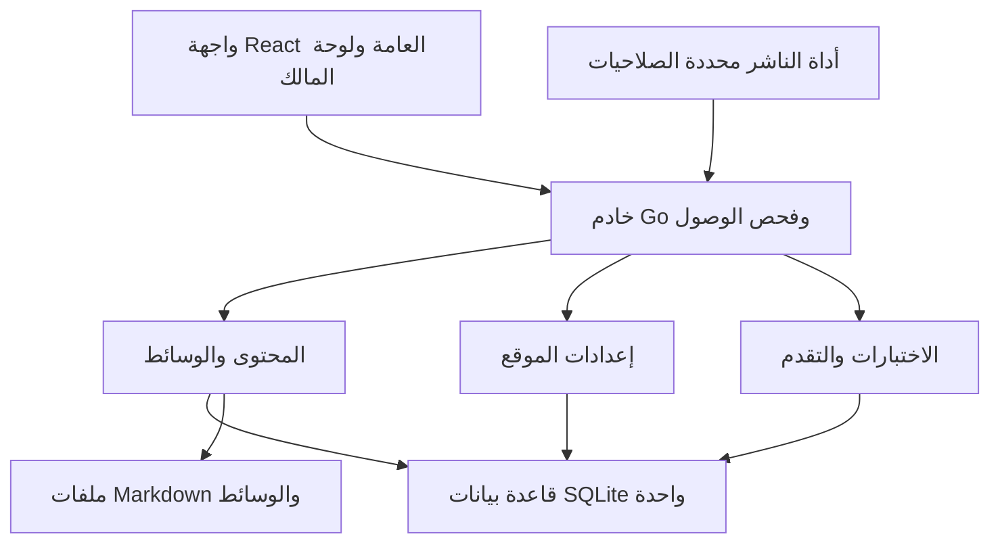

# عقود الإعدادات ومسارات التعلّم (Configuration and Learning Contracts)

[English](architecture-appendix-configurable-learning.md) · [البنية المعمارية](architecture.ar.md)

توضح هذه الوثيقة القيود الهندسية التفصيلية لإعدادات النظام، وضوابط الوصول لمسارات التعلّم، والمصادقة، والتخزين الدائم.

## 1. تطبيق مدمج واحد بمسؤوليات واضحة ومحددة

تُمثل هذه المكونات حزماً برمجية مدمجة داخل عملية Go التشغيلية نفسها، وليست خدمات مصغرة مستقلة؛ وتقع مسارات الحزم `internal/` الموضحة أدناه داخل مجلد `backend/`.

| الحزمة البرمجية | مسؤولية خادم Go | مسؤولية واجهة React |
| --- | --- | --- |
| `internal/auth` | الإعداد الأولي للمالك، ومفاتيح المرور (Passkeys) ورموز TOTP، وإدارة الجلسات، والحماية من CSRF، وتحديد معدل الطلبات، ونطاقات رموز الوصول | تسجيل الدخول، وإجراءات معيار WebAuthn في المتصفح، وإعداد عوامل المصادقة، والتحكم بالأمان والجلسات |
| `internal/siteconfig` | إعدادات الموقع، والملف الشخصي، والتسميات، والتحقق، وتطبيق التغييرات وتتبع تاريخها، وتوفير الإسقاط العام الآمن | نماذج ومعاينات الهوية البصرية والملف الشخصي والتسميات بالاعتماد على رموز نظام التصميم |
| `internal/content` | مراجعات Markdown الحالية، ومراجعة الترجمات، والنشر، والتصنيفات والوسوم، والمجموعات | صفحات القراءة العامة والتوثيق، ومحرر المحتوى، ومقارنة المراجعات، وأدوات النشر |
| `internal/learning` | تعريفات الاختبارات التقييمية وتصحيحها، وبوابات المسارات، والتقدم المجهول للمتعلمين، وقرارات منح الوصول | أداة بناء الاختبارات وعرضها، وشاشات الدروس المقفلة، وفهارس المسارات، وتتبع التقدم، وإعادة المحاولة |
| `internal/media` والتخزين | الرفع الدائم للملفات، والتحقق من قيود الغرض، والقراءة المنضبطة، وتتبع المراجع | طابور رفع الوسائط، ومنتقي الملفات، والمعاينات، والنصوص البديلة والترجمات النصية، ومكتبة الوسائط |
| `internal/http` وقاعدة البيانات | التوجيه المشترك، ومخططات الطلب والاستجابة، وهيكل صفحة HTML، ومعاملات SQL | عميل API محدد الأنواع، وتخطيطات المسارات، وحالات التحميل ومعالجة الأخطاء، وحالة النماذج المحلية |

تستدعي معالجات HTTP وأداة الناشر (publisher) خدمات التطبيق الداخلية نفسها؛ ويختص كود Go وحده بقراءة قاعدة بيانات SQLite والملفات المدارة على القرص. احرص على عدم ربط قواعد العمل بأي مكون React معين أو علامة تجارية محددة. وتتشارك مجموعات مسارات الواجهة العامة ومسارات المالك في مكونات العرض؛ ويمكن تحميل حزمة كود المالك تحميلاً كسولاً (lazy-loading)، مع التأكيد على أن تجزئة الحزم في المتصفح لا تمثل بأي حال طبقة تفويض أمنية.

تتشارك كافة مسارات تقديم الصفحات، وواجهات برمجة المحتوى، واستجابات طلبات الوسائط (GET وHEAD وRange)، وقراءة الاختبارات، وخلاصات المحتوى، ونتائج البحث في خدمة التحقق من الوصول نفسها؛ ويُحظر تماماً وجود أي مسار برمجي بديل يمكنه تجاوز بوابات واشتراطات الدروس.

## 2. الإعدادات: الحقول، والحفظ، والسلوك متعدد اللغات

### 2.1 ثلاثة أنواع متباينة من الإعدادات

| نوع الإعداد | مكان حفظه | أمثلة عملية |
| --- | --- | --- |
| إعدادات المشغل (Operator) | بيئة التشغيل أو ملفات الإعداد والأسرار المربوطة | اسم النطاق الأساسي (Base URL)، وقائمة الوكلاء الموثوقين، وجذر البيانات، ومعرف RP ID وأصول WebAuthn، ومفتاح التشفير، وحدود الرفع، ووجهة النسخ الاحتياطي |
| إعدادات المالك العامة القابلة للتحرير | سجلات SQLite ذات إصدارات متتبعة؛ مع بقاء ملفات الوسائط على القرص | لوحة الألوان، والشعار، والاسم، والصورة الشخصية، والغلاف، وسجل الخبرات، والروابط، وقسم "الآن"، وتسميات الواجهة، وخيارات الأيقونات والقوائم |
| تفضيلات القارئ | متصفح الزائر؛ مع احتفاظ الخادم بسجل إضافي لتقدم التعلّم | المظهر الفاتح/الداكن/تفضيل النظام، ولغة واجهة المستخدم؛ وملف تعريف ارتباط مبهم لتقدم التعلّم |

احذر تماماً من كشف أسرار المشغل عبر بيانات الموقع العامة، أو حزم بناء الواجهة، أو ملفات تصدير الإعدادات، أو ملفات السجلات، أو وسوم الأنماط المعروضة (style tags). ولا يتطلب تعديل الهوية البصرية أثناء التشغيل إعادة بناء حزم Webpack، أو إعادة تشغيل الخادم، أو إجراء أي تعديل على ملف رموز التصميم المصدري.

### 2.2 الهوية البصرية والعلامة التجارية (Branding and Identity)

يُخزن النظام وضع الشعار `logo_mode` باختيار إحدى القيم: الشعار النصي (`wordmark`)، أو الرمز الأحادي (`monogram`)، أو الصورة (`image`)، مع نص محدد للشعار، ورمز أحادي يتكون من 1 إلى 3 عناقيد محارف (grapheme clusters)، ومعرفات اختيارية لملفات وسائط الشعار والأيقونة المفضلة (favicon)، وخيارات أيقونات القوائم، ولونين أساسي وثانوي بصيغة hex. وتُحفظ الصورة الشخصية بمعزل عن الشعار ليتمكن الكاتب من الجمع بين صورته والشعار النصي في آن واحد. وعند غياب الصورة الشخصية يُعرض الرمز الأحادي؛ وعند غياب صورة الشعار يُستخدم الشعار النصي أو الرمز الأحادي. ويجب الحفاظ على عنصر تحكم موحد للهوية في الترويسة؛ فصورة مؤلف المقال داخل متن المحتوى لا تمثل قائمة ترويسة ثانية.

شروط ملفات الشعار والأيقونة المفضلة: ملفات تم التحقق من نوعها (PNG أو JPEG أو WebP) بحجم لا يتجاوز 1 ميغابايت. وشروط الصورة الشخصية: الصيغ نفسها، بحجم لا يتجاوز 2 ميغابايت، وأن تكون مربعة وبأبعاد لا تقل عن 600×600 بكسل. أما غلاف الصفحة الرئيسية الاختياري: فهو صورة نقطية معتمدة تخضع لحد الحجم المعتاد للصور البالغ 10 ميغابايت، مع توفير نص بديل مترجم وتحديد نقطة التركيز البؤري للقص. ويتم رفض الصور التي تحتوي على أبعاد بكسلات مفرطة أو تتجاوز حدود الحجم المسموح بها. وتُعاد فحوصات الغرض من الملف تلقائياً عند إشارة الإعدادات إلى معرف وسائط موجود مسبقاً. ويحظر رفع ملفات CSS أو الخطوط أو سكربتات JavaScript أو ملفات SVG.

يظل ملف `design-system/tokens.json` المصدر الأساسي والوحيد للقيم الافتراضية المضمنة في التطبيق؛ ويتم توليد ملف `tokens.css` عبر الأمر `node design-system/scripts/build-tokens.mjs` ويحظر تعديله يدوياً. ولا تتجاوز ألوان التثبيت المحفوظة سوى المتغيرات المسموح بها: `majorelle*`، و`on-majorelle`، و`sun`، و`on-sun`، ومتغيرات الظلال التابعة لها؛ بينما تظل رموز الألوان المحايدة، وحالات التنبيه، والمسافات، والخطوط خاضعة لسيطرة الكود المصدري.

اتبع قواعد الاشتقاق الموضحة في وثيقة `BRAND.md`، بالاعتماد على خوارزمية قطعية محددة الإصدار ومتجهات اختبار مشتركة بين Go وTypeScript. تحقق من صحة مدخلات الألوان بصيغة `#RRGGBB` المعيارية؛ واشتق درجات المظهرين الفاتح والداكن وألوان النصوص المقابلة، ثم اختبر الأزواج اللونية الفعلية على ألوان الخلفية (paper)، والسطح (surface)، والتعبئات الخفيفة، وتعبئات اللونين الأساسي والثانوي، وحدود مؤشرات التركيز. يجب ألا يقل معدل التباين عن 4.5:1 للنصوص العادية و3:1 للنصوص الكبيرة وحدود عناصر التحكم المنطبقة. ويجب توضيح أي درجات لونية تم تعديلها تلقائياً داخل المعاينة، مع حظر تطبيق أي لوحة ألوان تفشل في تحقيق نسب التباين المطلوبة؛ ولا تعتمد أبداً على نسب التباين المحسوبة في المتصفح.

يُصدر خادم Go قيم التجاوز الرقمية بصيغة hex بعد التحقق منها داخل هيكل الوثيقة الأولي بالاعتماد على معرف عشوائي لسياسة أمان المحتوى (CSP nonce)، مع استخدام سكربت مظهر مصرح به لتفادي وميض تغيير المظهر (FOUC). ولا يُسمح بدمج مدخلات المالك في كود CSS عشوائي. وتحتوي استجابة الإعدادات العامة على رقم إصدار خوارزمية الألوان وقيم السمة الفعالة؛ وتتبع معاينة المالك العقد نفسه تماماً. ويحتفظ القارئ بحرية اختيار المظهر الفاتح أو الداكن أو اتباع تفضيل النظام.

### 2.3 الملف الشخصي، وترويسة الرئيسية، والغلاف، وسجل الخبرات

| مجموعة الحقول | البيانات وقواعد التحقق |
| --- | --- |
| الهوية والترويسة | اسم العرض المترجم، والعنوان الوظيفي المترجم (مع دعم الأسطر الجديدة والتأكيد المحدود)، ونبذة موجزة لا تتجاوز 320 محرف Unicode، وشارة ملصقة اختيارية، ونصوص بديلة مترجمة للصورة والغلاف |
| إجراءات الترويسة | زر إجراء رئيسي واحد مصحوباً بما يصل إلى 10 روابط مرتبة تحمل معرفات ثابتة، وتسميات مترجمة، وعنوان URL، وأيقونة مصرح بها، وخيارات للظهور. ويُعد رابطا GitHub وLinkedIn اختيارين ولا يتم تخمينهما تلقائياً |
| قسم "الآن" (Now) | ما يصل إلى 3 صفوف ثابتة، يحتوي كل منها على تسمية مترجمة ونص لا يتجاوز 160 محرفاً؛ ويُخزن تاريخ `updated_month` بصيغة `YYYY-MM` ويُعرض مترجماً؛ مع إخفاء الصفوف الفارغة |
| سجل الخبرات المهنية | ما يصل إلى 20 مدخلاً مرتباً: معرف ثابت، والمسمى الوظيفي، والجهة، ووصف موجز مترجم، وتاريخ البداية والنهاية بصيغة سنة-شهر، وعلامة للوظيفة الحالية، ورابط URL اختياري يتم التحقق منه |
| نبذة تعريفية (About) | نص ملف شخصي منظم وموجز؛ وتستند السير الذاتية الأطول إلى وثيقة توثيق (`doc`) محلية تحتوي على متن Markdown يخضع لسير عمل مراجعات الملفات المعتاد |
| التواصل والتذييل | عنوان بريد إلكتروني عام، ونص اختياري للموقع الجغرافي، وحقوق النشر واسم العرض، وروابط التواصل، وعبارة دعوة مترجمة في التذييل. علماً بأن بريد تسجيل الدخول يظل سرياً ومستقلاً تماماً |
| تركيب الصفحة الرئيسية | أقسام ثابتة وفق النسخة (Version B)، مع إمكانية التحكم بظهور الغلاف، وقسم "الآن"، والمقالات، ومسارات التعلّم، مع تقييد أعداد العناصر. ولا تمثل هذه الشاشة أداة حرة لبناء الصفحات |

يقتصر التنسيق في العنوان والنبذة على قواعد تنسيق نصية بسيطة وخاملة ولا يُسمح باستخدام كود HTML تنفيذي. وتنتمي النصوص المطولة إلى ملفات Markdown المستقلة. وتقبل الروابط بروتوكول `https:`، وروابط `mailto:` المقيدة، والمسارات المحلية المطلقة؛ وتُرفض الروابط النسبية للبروتوكول (`//`)، والروابط المتضمنة لبيانات اعتماد، والمخططات الخطرة، ومحارف التحكم. ولا يقوم الخادم بجلب وجهات الروابط أو الصور الرمزية البعيدة تلقائياً.

يجب نشر أي وثيقة "نبذة عنا" محددة للملف الشخصي باللغة المعروضة قبل إتاحتها للعامة؛ ويمكن استبعاد دورها التحريري من أرشيف المقالات دون تجاوز ضوابط الوصول المعتادة. وتُخفى حقول الخبرات والتواصل الفارغة تلقائياً. ويكون الغلاف الاختياري معطلاً افتراضياً ويجب ألا يحجب نصوص الترويسة البارزة.

### 2.4 تسميات الواجهة مستقلة تماماً عن ترجمات المقالات

يمتلك كل مفتاح تسمية في الكود المصدري قسماً مخصصاً، وقيماً افتراضية باللغات الثلاث (EN/FR/AR)، وقائمة بالمتغيرات المسموحة (placeholders)، ووصفاً لغرض الاستخدام. ويتم حل **كل** نص مرئي في الواجهة من خلال هذا السجل، بما في ذلك التسميات التيسيرية لقارئات الشاشة، ورسائل الأخطاء، وحالات البيانات الفارغة، ونتائج الاختبارات التقييمية، وعناصر التحكم الإدارية. ويُرجع خادم Go رموز أخطاء ومعاملات محددة الأنواع برمجياً، ولا يعتمد منطق العمل على أي صياغات نصية قابلة للتعديل.

تُضاف التجاوزات المخصصة للمالك فوق القيم المضمنة في التطبيق. ويُعامل التجاوز الفارغ صراحة للغتين الفرنسية أو العربية كإشارة للرجوع إلى القيمة الإنجليزية الفعالة ويُحتسب ضمن التسميات الناقصة؛ بينما يؤدي أمر إعادة الضبط (Reset) إلى استعادة القيمة المضمنة المشحونة مع التطبيق لتلك اللغة. وعند غياب التجاوز، تُستخدم القيمة الافتراضية المشحونة للغة، ثم الإنجليزية كحل أخير. ولا يمكن لقيم التسميات الإنجليزية الأساسية أن تكون فارغة؛ وتتطلب المفاتيح المخصصة الجديدة توفير نص باللغة الإنجليزية. ويتم تمييز النصوص البديلة بلغتها الحقيقية واتجاه كتابتها الفعلي عند تضمينها ضمن صفحة بلغة أخرى.

تتبع المفاتيح نسقاً محدداً بصيغة `section.name` بأحرف صغيرة مع استخدام النقاط والشرطات؛ ولا يمكن إعادة تسمية المفاتيح الأساسية أو حذفها من لوحة التحكم. ويقتصر إنشاء مفتاح مخصص على حجز نص لموضع مدعوم في الإعدادات أو لاستخدام برمجي لاحق، دون أن يترتب عليه تغيير المسارات أو إضافة أدوات جديدة. يتم تهريب النصوص ورفض كود HTML والمتغيرات المجهولة. ويعلن السجل عن صيغ الجمع المدعومة ومعاملات الاستيفاء بأنواعها، مع تطبيق قواعد الجمع المحلية بما في ذلك الحالات الست للغة العربية بدلاً من تركيب أجزاء نصية مقتطعة؛ ويجب الحفاظ على كافة المتغيرات المطلوبة عند الترجمة أو استيراد البيانات.

تعتمد وظائف البحث، وتصفية الأقسام، وعرض العناصر الناقصة وعدّها، وإعادة الضبط للافتراضيات، وتصدير واستيراد ملفات JSON الخاصة بالمالك على حزمة تسميات موحدة ومحددة الإصدار؛ ويتم التحقق من مخطط البيانات وعدد المفاتيح وأطوالها قبل الحفظ. ولا يمكن تنفيذ أي أكواد برمجية أو تثبيت تبعيات من خلال نصوص التسميات.

يُسمح بالرجوع للنص البديل باللغة الإنجليزية في حقول الملف الشخصي وتسميات الواجهة فقط؛ **بينما يحظر تماماً تحويل المقالات أو الدروس أو الوثائق أو الاختبارات التقييمية بصورة صامتة إلى نصوص إنجليزية تحت واجهة عربية أو فرنسية**. بل يجب تقديم رابط صريح يوضح توفر المحتوى بلغات أخرى متاحة. ولا يؤثر اختيار اللغة في تفويض الصلاحيات أو احتساب تقدم التعلّم. وتعتمد اللغتان الإنجليزية والفرنسية اتجاه LTR، بينما تعتمد العربية اتجاه RTL مع عزل كتل الأكواد والمعرفات التقنية. وتُعد الفرنسية لغة إنتاجية كاملة ومدعومة رسمياً في النظام.

### 2.5 المعاينة، والمراجعة، والتطبيق، والسجل التاريخي

تمتلك كل من الإعدادات العامة (Settings)، والملف الشخصي (Profile)، والتسميات (Labels) وثيقة إعدادات مستقلة تخضع لنظام تتبع الإصدارات. وتُعدل الواجهة نسخة عمل محلية؛ ولا تؤدي المعاينة أو الإلغاء إلى تغيير البيانات العامة المنشورة. ويقوم أمر **الحفظ والتطبيق** (Save and apply) بإرسال لقطة معتمدة مصحوبة برقم الإصدار المتوقع `expected_version`؛ حيث يتحقق خادم Go من كافة الحقول والوسائط، ويحفظ مراجعة ثابتة غير قابلة للتعديل، ويحرك مؤشر الإصدار النشط داخل معاملة ذرية واحدة. ويؤدي تعارض الإصدارات (رمز 409) إلى الإبقاء على النموذج غير المحفوظ دون مساس. ولا توجد خطوة منفصلة أو خفية "لنشر الإعدادات".

يتضمن تطبيق التغييرات على حقول الملف الشخصي والتسميات المترجمة تأكيداً صريحاً بمراجعة واعتماد تلك القيم؛ حيث يسجل الخادم لقطة التغيير، وبصمة المصدر، واللغة، ومعرف المراجع. وتظل القيم القديمة المعتمدة معروضة للعامة حتى يكتمل اعتماد الترجمة الجديدة. وتقتصر الأتمتة على استيراد ترجمات المقالات كمسودات عبر واجهة برمجة المحتوى ولا تملك صلاحية تعديل إعدادات الموقع أو تطبيقها. ويمكن للمالك استيراد ترجمات الملف الشخصي والتسميات إلى مسودة عمل محلية ثم مراجعتها وتطبيقها بنفسه.

تقوم عملية الاستعادة بنسخ لقطة إعدادات تاريخية سابقة إلى مراجعة عمل جديدة، ويكون تطبيقها إجراءً صريحاً ومستقلاً. ويحظر حذف أي وسائط تشير إليها لقطات محفوظة في السجل التاريخي. ويقتصر استعلام القراءة العامة على النسخة المطبقة وإسقاطها الآمن فقط. ويتم إبطال استعلامات React المتأثرة بعد نجاح العملية، لترى الطلبات العامة الجديدة التغييرات المطبقة فوراً دون الحاجة لخدمة مزامنة حية بين تبويبات المتصفح.

## 3. هوية التعلّم، والاختبارات التقييمية، والدروس المقفلة

### 3.1 حفظ تقدم القارئ دون الحاجة لتسجيل حساب عام

يعتمد التطبيق في مرحلته الحالية على هوية تعلّم مجهولة للمتعلم، ولا يتم إنشاؤها إلا عند بدء مسار تعليمي أو إرسال إجابات اختبار تقييمي. يُصدر خادم Go رمزاً عشوائياً مشفراً ومبهماً في ملف تعريف ارتباط منفصل باسم `__Host-learning` بخصائص: Secure وHttpOnly وSameSite=Lax؛ وتحتفظ قاعدة بيانات SQLite ببصمة تجزئته، ومعرف الهوية، وتاريخ الانتهاء، وسجل التقدم. ولا يمنح هذا الرمز **أي صلاحيات للمالك**. وتتطلب أي تعديلات على التقدم بالاعتماد على ملف الارتباط التحقق من تطابق النطاق (origin) والحماية من CSRF.

توضح الواجهة للقارئ بجلاء: "يتم حفظ تقدمك في هذا المتصفح". ويؤدي مسح ملفات تعريف الارتباط أو التبديل إلى جهاز آخر إلى فقدان إمكانية الوصول إلى ذلك التقدم؛ ولا يتضمن النظام أي اعتماد على البريد الإلكتروني، أو تسجيل الحسابات، أو البصمة الرقمية للأجهزة (fingerprinting)، أو المزامنة التلقائية بين الأجهزة، أو الاسترداد التلقائي للحساب. وتوفر الواجهة خياراً صريحاً لإعادة ضبط تقدم التعلّم مع رسالة تأكيد واضحة تُبطل الرمز وتمسح سجل التقدم بالكامل. وتبلغ فترة الاحتفاظ بالبيانات في حالة الخمول 180 يوماً بشكل افتراضي، ويمكن للمشغل تعديلها وتوضيحها في إشعار الخصوصية؛ حيث يؤدي انتهاء الصلاحية إلى إعادة ضبط الوصول للدروس الأولى. وتستخدم معاينات المالك وضع معاينة مستقلاً ولا تُنشئ أي سجلات لاجتياز الاختبارات؛ مع إمكانية استخدام تدفق القارئ العادي لاختبار التسلسل. وتُعد ميزة مزامنة حسابات المتعلمين بين الأجهزة امتداداً مستقبلياً منفصلاً وليست متطلباً للمسار الأولي.

### 3.2 بيانات الاختبارات التقييمية وآلية التصحيح

يمكن لأي مقال أو درس أن يحتوي على اختبار تقييمي؛ ولكن الدروس المنتمية لمسارات تعلّم مرتبة هي وحدها التي يمكنها اشتراط النجاح في الاختبار لفتح الدرس التالي. وتتشارك المقالات والدروس في أدوات تحرير وعرض الاختبارات نفسها. وتُخزن بيانات التقييم كبيانات منظمة ومحددة النطاق في قاعدة بيانات SQLite وليست نسخة ثانية من متن المقال؛ وتُصدر ضمن بيانات الواجهة (frontmatter) بعد التحقق منها أو في ملف مرافق، مع بقاء متون المقالات والملفات المرفوعة كملفات عادية على القرص.

- يضم الاختبار ما بين 1 و20 سؤالاً: بأنماط الاختيار المفرد، أو الاختيار من متعدد، أو أسئلة الصواب والخطأ؛ وتضم أسئلة الاختيار من 2 إلى 8 خيارات. وتتطلب الأسئلة توفير نص صريح ومعرفات فريدة وثابتة؛ مع تحديد خيار صحيح واحد لأسئلة الاختيار المفرد والصواب والخطأ، وخيار صحيح واحد على الأقل لأسئلة الاختيار من متعدد؛ ويمتلك نمط الصواب والخطأ خيارين دلاليين ثابتين حصراً.
- يُحتسب لكل سؤال نقطة واحدة. وتُعد إجابة أسئلة الاختيار من متعدد صحيحة فقط عند مطابقة مجموعة الخيارات المختارة لمجموعة الإجابات الصحيحة تماماً دون احتساب درجات جزئية. وتكون درجة النجاح عدداً صحيحاً يتراوح من 1 إلى إجمالي عدد الأسئلة.
- تُكتب نصوص الأسئلة والخيارات والشروح كنصوص عادية ومحددة الطول بكل لغة. وتكون الإجابات عبارة عن معرفات الخيارات (IDs) وليست نصوص التسميات أو مواقعها في المصفوفة؛ ويتم رفض الإجابات الناقصة أو المكررة أو المجهولة أو مشوهة البنية قبل البدء بالتصحيح.
- تتيح سياسة التعلّم عدداً غير محدود من محاولات الإعادة للمتعلم. وتُفرض قيود معدل الطلبات لحماية موارد الخادم فقط وليس لتحديد سقف أقصى للمحاولات طوال العمر. وتكون إتاحة شروح الأسئلة خياراً يمكن تفعيله أو تعطيله؛ وتظل نتيجة الاختبار وحكم كل سؤال متاحين بعد إرسال الإجابات بالكامل.
- تحجب استجابات الاختبارات العامة مفاتيح الإجابات والشروح التي قد تكشف الحلول قبل إرسال المحاولة؛ ويمكن إرجاع الخيارات الصحيحة والشروح بعد إتمام التصحيح وفق رؤية المنهج التعليمي. وتظل هذه الاختبارات أدوات تدريبية وليست امتحانات رسمية مراقبة، ولا يمكن منع تداول الإجابات خارج المنصة.

يتضمن طلب تسجيل المحاولة رقم إصدار الاختبار، ومراجعة المحتوى، وإصدار المسار، والإجابات المختارة، مصحوبة بمفتاح منع تكرار الأثر (idempotency key). يتحقق خادم Go من هوية المتعلم، وحالة النشر، واستيفاء المتطلبات المسبقة، وتطابق الإصدارات، ثم يصحح الإجابات بالاعتماد على مفتاح الحل المخزن، ويسجل المحاولة وحالة الإكمال داخل معاملة ذرية قصيرة. وتُرجع الاستجابة الدرجة المستحقة، ودرجة النجاح، والتغذية الراجعة، وحالة الإكمال، والإجراء التالي المتاح. ولا يثق الخادم بأي قيم منطقية تدعي الاجتياز (`passed`) أو فتح القفل (`unlocked`) مرسلة من العميل. وتؤدي إعادة إرسال الطلب نفسه إلى إرجاع النتيجة السابقة؛ بينما تؤدي محاولة إرسال بيانات مختلفة بالمفتاح نفسه إلى وقوع تعارض. ويؤدي عدم تطابق إصدار الاختبار أو المسار إلى إرجاع رمز الخطأ 409 مع توجيه المتعلم لتحديث الصفحة، دون تصحيح إجاباته بناءً على أسئلة جديدة لم يطلع عليها.

### 3.3 النشر، والترجمة، وإصدارات الاختبارات

تشير مسودة المحتوى إلى إصدار ثابت من تعريف الاختبار مصحوباً بنصوص الأسئلة المترجمة للغة المستهدفة. ويؤدي نشر مراجعة المحتوى إلى نشر ارتباط الاختبار التابع لها تلقائياً؛ بينما لا يؤدي حفظ المسودة إلى التأثير على الاختبار الحي المنشور. وتتولى معاينة المالك تصحيح المسودة المحفوظة عبر نقطة نهاية خاصة دون تسجيل أي محاولات أو تقدم للمتعلمين. وتُشكل المعرفات الثابتة للأسئلة والخيارات، ومفاتيح التصحيح، ودرجة النجاح إصداراً تقييمياً موحداً عبر كافة اللغات؛ وتقتصر الترجمة على صياغة نصوص الأسئلة ومراجعتها مقابل ذلك الإصدار الدقيق، دون إمكانية تغيير الحل الصحيح أو خفض درجة النجاح.

قد يؤدي نشر تقييم جديد إلى بقاء ترجمات المقالات القديمة منشورة حياً، ولكن اختباراتها القديمة لا تمنح اجتيازاً جديداً للمتعلم؛ حيث يجب عرض رابط صريح يوجه المتعلم إلى لغة يتوفر بها الاختبار الحديث حتى يتم اعتماد ونشر الترجمات المحدثة. ويمكن لتعديلات النصوص البريئة التي لا تمس التقييم إعادة استخدام إصدار التقييم القائم نفسه. ويتطلب تفعيل أي اختبار كبوابة لمسار تعلّم تسجيل مراجعة واعتماد صريحين من المالك لذلك الإصدار الدقيق؛ ولا يمكن لأدوات النشر الآلي استبدال تقييم باختبار آخر غير مراجع حتى لو تطابقت درجة النجاح الرقمية.

تظل شهادات الاجتياز المكتسبة مسبقاً صالحة افتراضياً حتى بعد تصحيح أخطاء صياغة الأسئلة أو إعادة ترتيبها، مع الاحتفاظ برقم إصدار التقييم كدليل إثبات. وتبدأ حقبة تقدم المسار `progress_epoch` بالقيمة `1`. وفي حال رغب المالك صراحة في إلزام كافة المتعلمين بإعادة دراسة المحتوى، يتيح النظام إجراءً مستقلاً لإعادة ضبط تقدم المسار يرفع رقم الحقبة (epoch) بعد توضيح أثره الأمني؛ ولا يمكن لأي تعديل محتوى عادي أو رمز نشر آلي تصفير إنجازات المتعلمين بصورة صامتة.

### 3.4 القواعد المتسلسلة للمتطلبات المسبقة

تُبنى مسارات التعلّم كقوائم متسلسلة ومنتظمة، وليست رسوماً بيانية عشوائية للتبعيات. ويؤدي تفعيل خيار "الاجتياز يفتح الدرس التالي" في أداة بناء الاختبارات إلى تحديث بوابة مسودة في خطة نشر المسار؛ وتتطلب هذه البوابة وجود اختبار منشور وصالح في الدرس المصدر. وتتحقق عملية نشر الدرس والقاعدة المطابقة له من صحة كلا الإصدارين المتوقعين وتعتمد التغييرات معاً. ويرث الدرس التالي المستقبلي تلك البوابة تلقائياً عند ذلك الحد الفاصل.

لفتح الدرس رقم N، يجب على المتعلم اجتياز **كافة** بوابات الاختبارات السابقة الواقعة قبل هذا الدرس ضمن الحقبة الحالية (epoch)؛ مما يمنع تخطي البوابات عبر القفز المباشر للدرس N+1 عندما يكون الدرس N نفسه خالياً من الاختبارات. ولا يُنشئ الحد الفاصل الخالي من الاختبارات أي متطلب مسبق. وتشير البوابات دائماً إلى معرفات دروس ثابتة، ولا تعتمد أبداً على نص الرابط اللطيف أو الموضع الترتيبي وحده. وتتشارك كافة اللغات قواعد التقدم والإنجازات نفسها.

| حالة الدرس | الظهور العام للمتعلم | الحدث المسبب لتغيير الحالة |
| --- | --- | --- |
| مفتوح (Open) | عرض متن الدرس المنشور، والوسائط المصرح بها، والاختبار إن وجد | توفر المحتوى المنشور مع اجتياز كافة البوابات السابقة بنجاح |
| مقفل (Locked) | عرض العنوان والملخص المنشورين مع نص تقديمي اختياري، وتوضيح سبب القفل وأول متطلب مفقود، دون عرض متن الدرس | اجتياز الاختبارات المطلوبة، أو قيام المالك بإزالة بوابة القفل صراحة |
| قريباً (Soon) | عرض عنوان الدرس وموضعه في خريطة الطريق اختيارياً، دون روابط أو متن | نشر المحتوى لتلك اللغة؛ وقد ينتقل الدرس بعدها لحالة "مقفل" |
| مخفي (Hidden) | حجب تام للدرس، فلا يظهر له عنوان، أو رابط، أو مدخل، أو احتساب في العدادات | الإعلان الصريح عنه في خريطة الطريق أو نشر محتواه |

يختلف مفهوم اكتمال الدرس عن مجرد فتح إمكانية الوصول إليه: فالدرس المحتوي على اختبار يُعتبر مكتملاً بعد اجتياز الاختبار بنجاح؛ بينما يوفر الدرس الخالي من الاختبارات زر "تحديد كمقروء" (Mark as read) ولا يتاح هذا الإجراء إلا عندما يكون متن الدرس مفتوحاً للقراءة. فمجرد فتح الصفحة أو التمرير داخلها لا يُعد دليلاً على الفهم أو الاكتمال. وتعتمد عبارة "تم إكمال 3 من أصل 6" على سجلات الإكمال الفعلية، بينما تمثل عبارة "4 دروس منشورة" إحصائية مستقلة للمجموعة.

لا يؤدي إلغاء نشر درس يمثل متطلباً مسبقاً إلى فتح الدروس التالية له عن طريق الخطأ؛ حيث يستمر احتساب الاجتياز السابق للمتعلمين القدامى، بينما يرى المتعلمون الجدد رسالة تفيد بعدم توفر المتطلب السابق مع توفير رابط للغات البديلة المتاحة حيثما أمكن. وتُظهر الواجهة للمالك الأثر المترتب على المسار قبل تطبيق أي تعديل. وتتحقق قواعد إعادة الترتيب من منع التبعية الذاتية، والمواضع الترتيبية الخاطئة، ومنع وضع مصدر البوابة في موضع لا يسبق أهدافه؛ مع عرض الدروس المتأثرة قبل اعتماد الترتيب. ويحظر حذف بيانات أي اختبار مرتبط ببوابة نشطة حياً حتى تتم إزالة البوابة أو استبدالها صراحة. ولا يمكن سحب المحتويات التي تم تنزيلها مسبقاً على جهاز القارئ.

### 3.5 فرض قيود الوصول على كافة مسارات التوصيل

تُرجع نقطة نهاية المحتوى العامة رمز الخطأ 403 `lesson_locked` مصحوباً بحمولة ملخص آمنة عند طلب درس منشور لم يستوفِ المتعلم متطلباته المسبقة. وتُرجع مسارات صفحات HTML شاشة القفل بالحالة نفسها مصحوبة ببيانات وصفية آمنة ووسم `noindex`؛ بينما تظل المحتويات المفقودة أو غير المنشورة تُرجع رمز الخطأ 404، والمحتويات المتاحة تُرجع رمز النجاح 200. وتظل بيانات خريطة الطريق مستقلة تماماً عن استجابات المحتوى غير المنشور.

احذر تماماً من تضمين متن الدرس المحمي في شجرة DOM، أو استجابات JSON، أو خرائط المصدر (source maps)، أو المعاينات المخفية، أو نتائج البحث، أو خلاصات RSS، أو البيانات الوصفية للمشاركة، أو آليات الجلب المسبق (prefetch)، أو ملفات التصدير. ويجب استبعاد صفحات الدروس المقيدة من ملف خريطة الموقع (sitemap) الأولي؛ بينما يجوز لخلاصات المحتوى والبحث ربط الملخصات العامة مع تمييزها بعلامة قفل. ويحظر تماماً إجراء جلب مسبق صامت للدرس التالي المحمي. ولا توجد أي واجهة عامة تكشف مفاتيح إجابات الاختبارات أو سجل المراجعات الخاصة.

تتحدد صلاحية الوصول للوسائط وفق القواعد التالية: إما وجود جلسة مالك نشطة، أو وجود مرجع عام للملف في الملف الشخصي أو النصوص التقديمية العامة، أو وجود مرجع واحد على الأقل في محتوى منشور ومتاح للقارئ حالياً. وتُطبق هذه القاعدة الصارمة على طلبات الصور، وطلبات الفيديو (GET وHEAD وRange)، وملفات الترجمة النصية، وملصقات الغلاف، والنصوص المفرغة، وروابط التنزيل. وإذا أُعيد استخدام ملف وسائط في مقال عام مفتوح، فإنه يصبح متاحاً للعامة من خلال ذلك المقال؛ وتوضح مكتبة وسائط المالك هذا الاستخدام المشترك حتى لا يُظن خطأً أنه ملف خاص. وتبقى الوسائط المقتصرة على الدروس المقفلة محمية تماماً حتى وإن عُرف معرف الملف (ID). ويحظر إنشاء أي اسم مستعار ثابت (static alias) في الخادم الوكيل يوجه مباشرة لمجلد رفع الملفات.

يجب استخدام ترويسة `Cache-Control: no-store` على المحتوى المخصص، وسجلات التقدم، والمحاولات، وعمليات المصادقة، والوسائط المدارة. واحرص على تقييد أحجام الطلبات، ومعدل إرسال الاختبارات، وإنشاء الهويات؛ مع الاحتفاظ بالحد الأدنى من بيانات التقدم وإنهاء صلاحية الهويات والمحاولات الخاملة دورياً. والحد المقترح مبدئياً هو 10 محاولات اختبار في الدقيقة لكل هوية، مع سقف إضافي لكل عنوان IP يُضبط ليلائم الشبكات المشتركة. واحرص على تدوير سجلات إساءة الاستخدام والتدقيق وتحديد سقف أعلى لها لمنع تضخم قاعدة بيانات SQLite دون حدود.

## 4. مصادقة المالك والاسترداد

### 4.1 نمط الدخول المفضل الموصى به

يُعد استخدام **مفاتيح المرور عبر معيار WebAuthn مع اشتراط التحقق من المستخدم (User Verification)** نمط تسجيل الدخول المفضل والمعتمد للمالك. يقوم رمز PIN أو التحقق البيومتري في الجهاز بفك قفل المفتاح محلياً؛ ويتلقى الخادم تحدياً موقعاً رقمياً دون أن تصل إليه أي بيانات بيومترية. وخلافاً لرموز OTP المكتوبة، يربط معيار WebAuthn عملية المصادقة بالطرف المعتمد (RP ID) وأصل النطاق الفعلي؛ راجع مواصفات [W3C WebAuthn](https://www.w3.org/TR/webauthn-3/) وإرشادات [OWASP MFA](https://cheatsheetseries.owasp.org/cheatsheets/Multifactor_Authentication_Cheat_Sheet.html).

يدعم النظام خيار **كلمة المرور مصحوبة برمز TOTP** كبديل توافقي اختياري لا يتم تفعيله إلا بعد اكتمال تسجيله؛ وهو أقوى أمنياً من الاعتماد على كلمة المرور وحدها ولكنه ليس مقاوماً لهجمات التصيد الاحتيالي. ويظل هذا البديل معطلاً في حال اختيار نمط الاعتماد على مفاتيح المرور فقط. ولا يدعم النظام رسائل SMS أو رموز البريد الإلكتروني كخيارات افتراضية، ولا يتطلب وجود مزود لخدمات البريد لتشغيل التطبيق ذاتياً.

### 4.2 التهيئة ودورة حياة بيانات الاعتماد

يتم إنشاء حساب المالك الوحيد عبر أمر محلي في طرفية الخادم، ولا يوجد أي مسار تسجيل عام مفتوح. يُنشئ أمر الإعداد تصريحاً مؤقتاً أحادي الاستخدام وجلسة تسجيل مقيدة الصلاحيات؛ ويتم إدخال التصريح عبر نموذج تسجيل الدخول، وتجنب وضعه في الروابط أو ملفات السجلات أو بناء صورة الحاوية. ولا يُمنح المالك حق الوصول للوحة التحكم إلا بعد إتمام تسجيل واختبار مفتاح مرور معتمد، أو كلمة مرور مصحوبة برمز TOTP تم التحقق منه. ويتم تعطيل أمر التهيئة الأولي (bootstrap) فور اكتمال الإعداد؛ ويجب أن تفشل محاولات الوصول العام بأمان في حال عدم اكتمال الإعداد.

تتيح الواجهة للمالك تسجيل مفتاح مرور ثانٍ أو مفتاح أمان عتادي، وتولد 10 رموز استرداد عالية العشوائية (لا تقل عن 128 بت من العشوائية لكل رمز)، وتُعرض مرة واحدة ليحفظها المالك في مكان آمن غير متصل بالإنترنت. وتُخزن بصمات التجزئة للرموز فقط، وتُستهلك ذرياً داخل معاملات SQL لمنع إعادة استخدام الرمز نفسه في طلبات متزامنة.

في نمط كلمة المرور وTOTP، يحل رمز الاسترداد محل العامل الثاني بعد التحقق من كلمة المرور أولاً. وفي نمط مفاتيح المرور فقط، يمنح رمز الاسترداد جلسة مقيدة ومؤقتة لإعادة تسجيل عامل مصادقة بديل دون صلاحية لنشر المحتوى. وبعد استبدال العامل بنجاح، يتم إلغاء كافة جلسات المالك السابقة واشتراط تسجيل دخول كامل وجديد؛ مع إبراز هذا الحدث بوضوح في سجل التدقيق الأمني. وإذا فُقدت كافة العوامل ورموز الاسترداد، يمكن لمشغل الخادم الذي يمتلك وصولاً لـ VPS تشغيل أمر الاسترداد المحلي؛ فلا يوجد أي مسار عام عبر الويب لتعطيل المصادقة متعددة العوامل. ويقوم هذا الأمر بإلغاء التحديات والجلسات المعلقة، وبدء جلسة تسجيل مقيدة، وتدوين العملية في السجل.

وبخلاف إجراءات التهيئة والاسترداد المقيدة، تتطلب العمليات الحساسة (مثل إضافة أو إزالة عامل مصادقة، أو تغيير كلمة المرور أو بريد الدخول، أو إعادة توليد رموز الاسترداد، أو إنشاء رموز الناشر، أو إعادة ضبط المصادقة) إثبات مصادقة كاملة وحديثة (نافذة الحداثة الأولية هي 5 دقائق). ويحظر النظام حذف آخر وسيلة دخول صالحة للاستخدام. ويؤدي التعطيل أو الاسترداد إلى إلغاء الجلسات المعنية، كما يؤدي استبدال بذرة TOTP إلى إبطال البذرة القديمة فوراً. وتكشف الواجهة أسماء الأجهزة، وأوقات الإنشاء، وآخر استخدام، وخيارات الإلغاء دون تسجيل أي أسرار. ولا تتحول إشعارات البريد الإلكتروني المستقبلية إلى سلطة لإجراء الاسترداد.

### 4.3 التدابير الأمنية في جانب الخادم وإدارة الجلسات

تعتمد الحماية على مكتبات Go البرمجية المعتمدة والمدعومة لمعايير WebAuthn وTOTP واشتقاق تجزئة كلمات المرور، وتجنب كتابة تشفير مخصص.

| المجال الأمني | السلوك والضوابط المطلوبة |
| --- | --- |
| WebAuthn | استخدام بيانات اعتماد قابلة للاكتشاف (discoverable credentials) لتسجيل الدخول دون كتابة اسم المستخدم، مع استخدام معرف مالك مبهم؛ والتحقق من التحدي، ونوع الإجراء، والتطابق التام لأصل النطاق ومعرف RP ID، والتوقيع الرقمي، وربط الاعتماد بالمالك، وحضور المستخدم والتحقق منه. وتكون التحديات صالحة لمرة واحدة وتلغى بعد 5 دقائق وترتبط بالغرض والجلسة. وتدير المكتبة المعرف والمفتاح العام والعداد والبيانات الوصفية للنسخ الاحتياطي. ويشترط التحقق من المستخدم (UV) عند التسجيل والدخول، مع تطبيق قواعد المكتبة لمتابعة عدادات المفاتيح المتزامنة |
| كلمات المرور | خوارزمية Argon2id مع إضافة ملح عشوائي (salt) ومعاملات قياسية متوافقة ومقاسة لموارد خادم VPS؛ مع حظر تخزين كلمات المرور بنص صريح، أو استخدام التشفير كبديل للتجزئة، أو اقتطاع النصوص، أو ابتكار دوال تجزئة محلية؛ راجع [إرشادات OWASP لتخزين كلمات المرور](https://cheatsheetseries.owasp.org/cheatsheets/Password_Storage_Cheat_Sheet.html) |
| رموز TOTP | رموز من 6 أرقام بخطوات تحديث كل 30 ثانية مع تسامح زمني دقيق وموثق؛ والرفض الذري التام لأي خطوة زمنية تم قبول رمزها مسبقاً لمنع إعادة الإرسال. ولا يمنح التحدي المعلق بعد إدخال كلمة المرور أي صلاحيات للمالك وينتهي بعد 5 دقائق |
| سر TOTP | تشفير البذرة بخوارزمية تشفير موثقة باستخدام مفتاح تشفير للمشغل يقع خارج قاعدة بيانات SQLite؛ فالاشتقاق التجريدي لا يتيح التحقق من الرموز المستقبلية. ويقتصر عرض رمز QR والبذرة على مرحلة التسجيل فقط مع وسم `no-store` وعدم التسجيل في السجلات؛ مع حفظ نسخة احتياطية آمنة للمفتاح بشكل منفصل |
| تحديد معدل الطلبات | فرض حدود على مستوى الحساب وعلى مستوى عناوين IP الموثوقة تشمل محاولات كلمات المرور، وTOTP، وإتمام WebAuthn، والتهيئة، والاسترداد. ويؤدي تسجيل 5 إخفاقات إلى حظر مؤقت لمدة 15 دقيقة مبدئياً؛ وتُرجع الحسابات المجهولة والخاطئة رسائل أخطاء متكافئة. وتُطبق حدود تدريجية على مستوى IP قبل فرض القفل الشامل لحساب المالك لتقليل مخاطر حجب الخدمة؛ ولا يؤدي تغيير التحدي إلى تصفير العدادات |
| إدارة الجلسات | جلسات عشوائية ومبهمة في جانب الخادم مع حفظ تجزئة الرمز في SQLite؛ باستخدام ملف تعريف الارتباط `__Host-owner` بخصائص: Secure وHttpOnly وSameSite=Strict وPath=/ دون تعيين Domain. وتُدوّر الجلسة فور المصادقة؛ بمهلة خمول قدرها 30 دقيقة وحد أقصى مطلق قدره 12 ساعة. ولا تُحفظ أي رموز JWT أو رموز ناشر في localStorage |
| كتابات المتصفح | التحقق الصارم من رمز CSRF وتطابق ترويسة Origin في كافة العمليات بما فيها تسجيل الخروج، وإدارة العوامل، وتعديل الإعدادات؛ مع حظر إحداث أي تغييرات في الحالة عبر طلبات GET، فالاعتماد على SameSite وحده غير كافٍ؛ راجع [إرشادات OWASP لإدارة الجلسات](https://cheatsheetseries.owasp.org/cheatsheets/Session_Management_Cheat_Sheet.html) |
| الخادم الوكيل والنشر | تفعيل HTTPS في الإنتاج؛ مع تحديد صريح للنطاق الأساسي ومعرف RP ID وقائمة الأصول المسموحة؛ وقصر الثقة في ترويسات التمرير على عناوين الوكلاء المحددين فقط. وتغيير اسم النطاق يمثل عملية ترحيل واسترداد لتسجيل المفاتيح، ولا يجوز معالجته بتوسيع نطاق الأصول المقبولة سراً |
| سجل التدقيق الأمني | تسجيل نتائج عمليات الأمان، وتعديل الإعدادات، والنشر، ومعرفات الطلبات؛ مع الحظر التام لتسجيل كلمات المرور، أو بذور QR، أو رموز OTP، أو الرموز الخام، أو رموز الاسترداد، أو حمولات إجابات الاختبارات، أو متون نصوص Markdown الخاصة |

يُرجع التحقق الناجح من كلمة المرور تحدياً معلقاً مقيد الصلاحيات فقط، **ولا يُرجع** ملف تعريف ارتباط الجلسة العادي. ويظل المسار `POST /api/v1/session` نقطة الدخول لكلمة المرور ولكنه لم يعد يكمل تسجيل الدخول بمفرده. ويؤدي تسجيل الخروج إلى إلغاء الجلسة الحالية؛ وتتيح شاشة الأمان إلغاء كافة الجلسات النشطة دفعة واحدة. وتُعد رموز الناشر بيانات اعتماد برمجية مستقلة: قابلة للإلغاء، ومحددة الصلاحيات بدقة، ولا تصلح لتسجيل دخول المالك، أو تعديل الإعدادات، أو إدارة عوامل المصادقة، أو انتحال شخصيات المتعلمين.

### 4.4 الأجهزة الجديدة والنسخ الاحتياطية المستقلة

يُعد [دليل الأجهزة الجديدة واسترداد الحساب](passkey-access.ar.md) جزءاً لا يتجزأ من هذا العقد البرمجي. يجب دعم تسجيل عدة مفاتيح مرور مستقلة وتدفقات معيار WebAuthn القياسية بالاستعانة بالهاتف الذكي أو بمفاتيح الأمان المادية حيثما تتوفر؛ مع تجنب حصر التسجيل في المصادق المدمج بالجهاز فقط. قد يتوفر المفتاح المتزامن عبر مزود الخدمة السحابي، أو يمكن للهاتف مصادقة دخول جهاز حاسوب جديد دون الحاجة لنسخ مفتاحه الخاص إليه. وتذكر أن النسخ المتزامنة من بيانات الاعتماد نفسها لا تُعد عوامل مصادقة احتياطية مستقلة. وفّر إمكانية تسجيل مفتاح احتياطي مستقل ورموز استرداد غير متصلة بالإنترنت، مع إتاحة إجراء الاسترداد المقيد عبر خادم VPS عند الحاجة القصوى. واحرص على اختبار تدفقات تسجيل الأجهزة الجديدة وسيناريوهات الفقد والاسترداد، وليس مسار النجاح المعتاد فقط.

## 5. إضافات مخطط SQLite وحدود الملفات

تمثل هذه السجلات نماذج منطقية تُترجم إلى ترحيلات SQL؛ ويجوز دمج الجداول متى ما حافظ ذلك على القيود والضمانات المطلوبة.

| السجلات المنطقية | الحقول والقيود الجوهرية |
| --- | --- |
| وثائق ومراجعات الإعدادات | نوع الوثيقة (`site` أو `profile` أو `labels`)، ورقم الإصدار، والمراجعة المطبقة، ولقطة JSON ثابتة ومحددة النطاق، وإصدار المخطط وخوارزمية الألوان، ومعرف الفاعل وتوقيته. وتندرج قيم الملف الشخصي والتسميات المترجمة وبصمات مراجعة الترجمة ضمن تلك اللقطة؛ لتحل محل سلطة الإعدادات السابقة دون تكرارها |
| مراجع وسائط الإعدادات | مراجعة الإعدادات + معرف الوسائط + الدور الوظيفي للملف؛ وتضمن قيود المفاتيح الأجنبية حفظ السجل التاريخي وحكم الظهور العام للملف المطبق |
| سجل التسميات | مفاتيح الكود، والقيم الافتراضية، ومخطط المتغيرات المسموحة؛ بينما تقتصر SQLite على تخزين التجاوزات والمفاتيح المخصصة فقط؛ وتكون عمليات الاستيراد محددة الإصدار ومتحققاً منها |
| تعريفات وإصدارات الاختبارات | معرفات ثابتة للاختبار وعنصر المحتوى، وإصدار ثابت يضم معرفات الأسئلة والخيارات، ومفاتيح الإجابات، وعلامة النجاح، وسياسة إظهار الشروح. ويرتبط كل تعريف بعنصر محتوى واحد |
| توطين وارتباط الاختبارات | مراجعة المحتوى + إصدار الاختبار + اللغة؛ متضمنة نصوص الأسئلة والخيارات والشروح المترجمة ومرجع المراجعة. ويكون هناك ارتباط واحد لكل مراجعة محتوى، مع خلو الإسقاط العام من مفاتيح الإجابات |
| مراجعات التقييم | الإصدار المعياري الدقيق للاختبار، ومعرف المالك، وتوقيت المراجعة؛ ويشترط توفر هذا السجل قبل تفعيل الاختبار كبوابة لمسار تعلّم |
| خطط وبوابات المسارات | أعضاء مرتبون برقم إصدار، وسياسة الدرس المصدر والتقييم، ومؤشر الخطة النشطة، ورقم الحقبة (epoch)، وضمان فريدية العضوية والموضع الترتيبي. ولا تؤثر مسودة الخطة على القواعد الحية المنشورة |
| إعلانات خريطة الطريق | عنوان وملخص وموضع عام صريح لكل لغة مع معرف عنصر اختياري؛ دون نشر تلقائي لبيانات المسودات |
| هويات التعلّم | معرف الهوية، وبصمة تجزئة فريدة لرمز مبهم، وتوقيتات الإنشاء وآخر نشاط وانتهاء الصلاحية؛ دون وجود أي حقول لحسابات شخصية |
| محاولات الاختبارات | معرف الهوية، ومعرف العنصر، وإصدارات المحتوى والاختبار والمسار، ورقم الحقبة، والدرجة المستحقة والإجمالية وحالة الاجتياز، والتغذية الراجعة المحددة، وبصمة مفتاح عدم التكرار والطلب، والطابع الزمني؛ مع تجنب تخزين حمولات الإجابات الخام التي تتجاوز حاجة عقد التغذية الراجعة |
| إكمال التعلّم | قيد فريد يجمع: (الهوية + المسار + الدرس + الحقبة)، وطريقة الإكمال (`quiz_pass` أو `read`)، ودليل المحاولة والإصدار والوقت؛ ولا يؤدي فشل المحاولات اللاحقة إلى محو اجتياز مكتسب |
| بيانات اعتماد المالك | سجل المالك الوحيد مع عدة مفاتيح عامة مسجلة لمفاتيح المرور؛ وتجزئة كلمة المرور الاختيارية وبذرة TOTP المشفرة، والخطوة الزمنية المقبولة، وحالة وإصدار عوامل المصادقة |
| تحديات المصادقة والاسترداد | الغرض الأمني، ومعرف مجزأ للجلسة أو التصريح، وبيانات التحدي وحالته، وتوقيت الانتهاء والاستهلاك، وعدد الإخفاقات؛ وبصمات رموز الاسترداد الأحادية الاستخدام |
| الجلسات، ورموز API، والتدقيق | سجلات الجلسات والرموز في جانب الخادم مضافاً إليها طريقة المصادقة وتوقيتها، وتواريخ الانتهاء والإلغاء، ونطاق الصلاحيات؛ وسجلات التدقيق المحدودة وحالة تحديد معدل الطلبات |

تُعد نصوص الاختبارات وإعدادات الموقع بيانات منظمة ومحدودة تلائم طبيعة قاعدة بيانات SQLite. أما متون المقالات والدروس والوثائق وصفحة التعريف (`.md`)، وملفات الصور والفيديو ومستندات PDF وملفات الترجمة النصية فهي ملفات عادية تظل محفوظة على نظام الملفات. وتظل قواعد المسارات النسبية المولدة، وتفريغ الملفات على القرص قبل اعتماد المعاملة في قاعدة البيانات، والتحقق من البصمات، وثبات المراجعات، والنسخ الاحتياطي المنسق سارية المفعول بالكامل.

يتم تفعيل قيود المفاتيح الأجنبية، والفهارس الفريدة، ومعاملات الكتابة القصيرة. وتُعتمد محاولة الاختبار وحالة الاجتياز ونتيجة منع تكرار الأثر معاً في معاملة ذرية واحدة. وتتحقق عمليات النشر، وتحديث خطط المسارات، وتطبيق الإعدادات من مطابقة الإصدارات المتوقعة داخل المعاملة نفسها. وتُسجل التوقيتات بتوقيت UTC وتُعرض للمستخدم بتنسيق يتناسب مع لغته المحلية؛ ولا تُمثل شهور الخبرة المعروضة توقيتات مصطنعة لمنتصف الليل.

## 6. امتدادات واجهات البرمجة (API) ومصفوفة الصلاحيات

يحافظ التطبيق على مسارات `/api/v1` ونقاط نهاية المحتوى والوسائط القائمة. وتحدد المسارات الموضحة أدناه مساحة العقد البرمجي الجديد؛ مع التأكيد على أن مواصفات OpenAPI الدقيقة هي ناتج تنفيذي للمشروع. وتُطبق معايير المعرفات المبهمة، والترقيم المحدود للصفحات، وهيكلة الأخطاء، وحجب المسارات الفيزيائية للملفات عبر كافة الواجهات. وتتطلب عمليات الكتابة المعتمدة على ملفات ارتباط المالك التحقق من رمز CSRF، بينما تتطلب عمليات الناشر التحقق من نطاقات الصلاحيات.

| واجهة البرمجة (API) | الجهة المستدعية والغرض الوظيفي |
| --- | --- |
| `GET /public/site?locale=…`, `GET /public/labels?locale=…` | تقع تحت `/api/v1`؛ وتُرجع الإعدادات والتسميات المطبقة والآمنة فقط. وتتضمن حمولة الموقع العامة الألوان الفعالة، والبيانات الوصفية للغة والبدائل، وبيانات الملف الشخصي |
| قراءة المحتوى والمجموعات والبحث القائمة | حل موحد لقيود الوصول، وإرجاع الإسقاطات الآمنة للدروس المقفلة وخريطة الطريق كما وُضّح سابقاً. ويمكن للقوائم العامة جلب تقدم القارئ في طلب منفصل لتفادي معاملة العدادات الشخصية كبيانات عامة قابلة للتخزين المؤقت |
| `GET/PUT /settings`, `/profile`, `/labels` | قراءة وتطبيق الإعدادات للمالك فقط برقم إصدار؛ مع مسارات فرعية للاستيراد والتصدير والسجل التاريخي والاستعادة. ويختص مسار `/settings` بإعدادات الموقع والهوية البصرية، ولا يمثل مخزناً ثانياً للملف الشخصي |
| `POST /settings/preview` | التحقق واشتقاق لوحة الألوان وفحص نسب التباين للمالك فقط دون حفظ البيانات أو نشرها للعامة |
| `POST /learning/session` | إنشاء هوية تعلّم مجهولة ومقيدة الصلاحيات؛ ولا تؤدي طلبات GET المجردة لزيارة الصفحات إلى إنشاء صفوف في قاعدة البيانات |
| `GET/DELETE /learning/progress` | قراءة أو تصفير تقدم الهوية الحالية فقط؛ ولا يُقبل أي معرف هوية اعتباطي يُرسل من المتصفح |
| `GET /learning/paths/{key}` | المخطط العام للمسار مصحوباً بحالة وصول وإكمال القارئ الحالي؛ مع وسم `no-store` |
| `GET /learning/lessons/{key}/{locale}/quiz` | أسئلة الاختبار وإصداره الحالي لدرس منشور ومتاح دون كشف مفاتيح الإجابات؛ ويتوفر مسار مماثل لاختبارات المقالات العامة |
| `POST /learning/quizzes/{version}/attempts` | تصحيح الإجابات للهوية الحالية، والتحقق من المتطلبات المسبقة والإصدار، وإرجاع التغذية الراجعة والتقدم بنمط يمنع تكرار الأثر (idempotent) |
| `POST /learning/lessons/{key}/read` | تسجيل إكمال درس مفتوح لا يحتوي على اختبار؛ دون إمكانية تجاوز أي اختبار أو شرط نشر |
| واجهات مسودات ونشر المحتوى القائمة | تتضمن ربط الاختبارات، ومعرفات المصدر والمراجعة، ورقم إصدار خطة المسار المتوقع عند الاقتضاء؛ مع تطبيق قواعد المعاملات الموحدة نفسها |
| `POST /content/{key}/{locale}/quiz-preview` | تصحيح مسودة اختبار للمالك دون حفظ أي تقدم للمتعلمين |
| واجهات المجموعات القائمة و`POST /collections/{key}/progress-reset` | إدارة ترتيب المسار، وبوابات القفل، والإعلانات، وإعادة ضبط الحقبة (epoch) للمالك؛ وتتطلب عملية التصفير إثبات مصادقة حديثة |
| `POST /session` ثم `POST /session/totp` أو `/session/recovery` | تدفق كلمة المرور الاختياري، والتحقق المعلق من MFA، ثم فتح جلسة كاملة أو بدء تسجيل استرداد مقيد |
| `POST /auth/passkeys/login/options` و`/verify` | بدء والتحقق من تسجيل الدخول بمفتاح المرور دون فتح التسجيل للعامة |
| `GET /session`, `DELETE /session` | قراءة حالة مصادقة المالك الحالية وتسجيل الخروج، دون كشف أسرار الجلسة في استجابة JSON |
| `/security/passkeys`, `/security/totp`, `/security/recovery-codes`, `/security/sessions`, `/security/tokens` | عمليات إدارة الأمان للمالك مع اشتراط مصادقة حديثة للتغييرات الحساسة؛ وتعتمد عمليات التسجيل على نقاط نهاية تحديات مخصصة لكل غرض |

تندرج كافة المسارات المختصرة المذكورة في الجدول تحت البادئة `/api/v1`. وتُستخدم رموز حالة HTTP القياسية: 400 للطلبات المشوهة، و401 لاشتراط المصادقة، و403 للمنع وحالات القفل، و404 للمحتوى غير المتاح، و409 لتعارض المراجعات أو مفاتيح العمليات عديمة الأثر، و413 للطلبات التي تتجاوز الحجم المسموح، و422 للحقول غير الصالحة، و429 مع ترويسة Retry-After عند تجاوز معدل الطلبات. وتقتصر أخطاء الدروس المقفلة على إرجاع البيانات العامة المصرح بها فقط؛ ولا تكشف أخطاء المصادقة عما إذا كان معرف تسجيل الدخول موجوداً في النظام.

| الصلاحية والقدرة | الزائر العام | ملف ارتباط التعلّم | جلسة المالك | رمز الناشر البرمجي |
| --- | --- | --- | --- | --- |
| استعراض الصفحات والملخصات العامة | نعم | نعم | نعم | الوصول العام المعتاد |
| الوصول لمتون ووسائط الدروس المقفلة | الدروس غير المقيدة في البداية فقط | بعد اجتياز المتطلبات المسبقة | معاينة المالك؛ دون تسجيل تقدم وهمي | نطاق قراءة المحتوى المصرح به صراحة فقط |
| إرسال الاختبارات وتسجيل تقدم القراءة | يلزم إنشاء هوية تعلّم أولاً | الهوية الخاصة به فقط | استخدام المعاينة أو تجربة تدفق التعلّم | لا |
| كتابة المسودات ورفع الوسائط | لا | لا | نعم | النطاق المحدد للمحتوى والوسائط والمجموعة المصرح بها فقط |
| نشر المحتوى واعتماد الترجمات | لا | لا | نعم | نطاق النشر الصريح؛ وتظل مراجعة الترجمات حصرية للمالك |
| تعديل الإعدادات، والتسميات، والمصادقة، وبوابات المسارات، وتصفير التقدم | لا | لا | نعم؛ مع اشتراط مصادقة حديثة للإجراءات الحساسة | لا |

يستطيع عميل النشر الآلي إرسال نصوص Markdown، والوسائط، ومسودات الاختبارات المنظمة باستخدام صلاحيات كتابة المحتوى والاختبارات المحددة النطاق. ولا يمكن لرمز برمجي يمتلك صلاحية نشر الدروس أن يُغير بوابات المسارات سراً، أو يصفر تقدم القراء، أو يخفض درجة النجاح لاختبار منشور، أو يطبق هوية بصرية، أو يدير بيانات الاعتماد؛ فهذه العمليات تتطلب إجراءات مباشرة من المالك. ويستمر النشر التلقائي للغة الأصلية ضمن النطاق المصرح به فقط، بينما تظل الترجمات وبوابات القفل الجديدة خاضعة للمراجعة والتدقيق. ويُعد التوصيل إلى Notion عملية نشر مستقلة؛ وتظل تفاعلات الاختبارات وسجلات التقدم ملكاً للمدونة وحدها وليست قاعدة بيانات متزامنة داخل Notion.

## 7. تثبيت مفتوح المصدر قابل لإعادة الاستخدام

يخدم كل تثبيت موقعاً لمالك واحد؛ وتعني قابلية إعادة الاستخدام قدرة أي شخص آخر على تثبيت الإصدار نفسه، وضبط نطاقه وهويته البصرية الخاصة، ونشر كتاباته المستقلة، دون أن يقتضي ذلك دعم تعدد المستأجرين (multi-tenancy)، أو المنظمات، أو الاشتراكات، أو الخوادم المتعددة لهذا التثبيت.

- حافظ على بقاء `backend/cmd/blog`، و`backend/cmd/publisher`، و`backend/internal/…`، و`backend/migrations/`، و`frontend/`، و`ui/`، و`design-system/`، و`deploy/`، و`docs/` داخل هذا المستودع. تُعرف عقود واجهات البرمجة (API) باستقلالية تامة عن الواجهة الأمامية، مع تجنب إضافة حزم تطوير (SDK) أو خدمات داخلية قبل الحاجة إليها، وإبقاء أي تكاملات مستقبلية اختيارية خلف واجهات Go برمجية صغيرة.
- يتم شحن التطبيق ببيانات محتوى وملف شخصي فارغة تماماً مع قيم افتراضية محايدة للتثبيت؛ حيث تجمع شاشات الإعداد الأولي اسم المالك، ورابط موقعه، وشعاره، ومعلومات التواصل التي يختارها. ولا يتضمن كود الإنتاج أي روابط تواصل، أو مسمى وظيفي، أو مدينة، أو بريد إلكتروني، أو كلمة مرور، أو سجل تقدم، أو منشورات خاصة بمالك بعينه؛ وتظل البيانات التجريبية المعزولة مخصصة للاختبار والعرض فقط.
- يتضمن التطبيق قيماً افتراضية للواجهة باللغات الثلاث (EN/FR/AR)، وخطوطاً مدعومة، وقائمة بيضاء للأيقونات المصرح بها، مع الاحتفاظ بكافة تراخيص الخطوط وإشعارات التبعيات الأصلية. وتُعد النصوص التسويقية العامة، وحقوق ملكية المحتوى، وترخيص برمجيات المحرك اهتمامات مستقلة ومنفصلة عن بعضها.
- يُعد ملف الترخيص الجذري `LICENSE` إشعار ترخيص 0BSD قديماً يذكر Gatsby؛ ويجب الاحتفاظ به في هذا التوثيق. وقبل إصدار نسخة قابلة لإعادة الاستخدام، يجب تسجيل الترخيص المعتمد لمحرك التطبيق الجديد وتوثيق سجل دقيق لمصادر وحقوق الطرف الثالث؛ دون تغيير اسم حقوق النشر سراً أو معاملة المقالات والصور الشخصية ككود مفتوح المصدر للمحرك.
- يوفر المستودع ملف `.env.example` مع تعيين قيم نائبة واضحة، وإعدادات Docker Compose، ومجلد بيانات دائم واحد، وحزم أدوات وتبعيات برمجية مثبتة الإصدارات، مع توثيق كامل لأوامر الإعداد، والترقية، والنسخ الاحتياطي، والاستعادة. ويتم رفض بيانات الاعتماد الافتراضية والنائبة عند بدء التشغيل في الإنتاج. وتُحدد إعدادات Webpack العامة عبر قائمة بيضاء صريحة وتُعزل تماماً عن بيئة الخادم السرية.
- وثّق بوضوح إرشادات المساهمين، وحدود الحزم، ومخطط الترحيلات، وتوافقية واجهات البرمجة، والتدويل والتوطين اللغوي، وفحوصات إمكانية الوصول، وقنوات الإبلاغ الأمني، والمتصفحات المدعومة، وسياسة تحزيم الإصدارات وتحديثها. ويجب ألا تتطلب عملية البناء وجود حسابات خاصة في Notion أو لدى مزودي خدمات الذكاء الاصطناعي.
- إتاحة ميزة تصدير شاملة وقابلة للنقل للمالك: تتضمن بيان المحتوى، والإعدادات، وتجاوزات التسميات، والتصنيفات والوسوم، والمجموعات، ومتون Markdown، وبيانات الاختبارات التقييمية، والوسائط المشار إليها؛ مع استبعاد بيانات الاعتماد، والجلسات، وسجلات المتعلمين، وأسرار API، وإعدادات المشغل الخاصة افتراضياً. وتخضع المعرفات والمسارات للفحص وإعادة التعيين عند الاستيراد؛ وتُعامل المقالات المستوردة كمسودات ما لم تكن هناك عملية استعادة مستقلة تحفظ الحالة المنشورة صراحة.
- توفير آلية نسخ احتياطي متسقة لكامل قاعدة بيانات SQLite والملفات المشار إليها على القرص، بما يشمل تعريفات الاختبارات، وسجلات التقدم، والإعدادات المطبقة والمحفوظة. وتُحفظ مفاتيح المصادقة المشفرة ضمن حزمة استرداد محمية ومستقلة. وتتم الاستعادة في وضع الصيانة مع تعطيل بيانات اعتماد المالك، والجلسات، والتحديات المعلقة، ورموز الاسترداد، ورموز API المستعادة من اللقطة؛ نظراً لتعذر معرفة ما إذا كانت قد أُلغيت بعد أخذ تلك النسخة. ويتم إعادة تسجيل المالك محلياً عبر أمر المشغل وإعادة إصدار الرموز اللازمة قبل فتح لوحة التحكم وخدمات الناشر، مع إبطال ملفات تعريف ارتباط التعلّم. وتذكر أن استعادة البيانات لا تُعيد تفعيل أي مفتاح مرور أو اعتماد تم إلغاؤه مسبقاً. ويؤدي إجراء التعافي من الكوارث عمداً إلى تصفير وصول متصفحات القراء المجهولين لتقدمهم السابق؛ فسجلات المحاولات المحفوظة لا تضمن استعادة الهوية عبر الأجهزة المختلفة، ويجب توضيح هذا القيد في دليل الاسترداد.
- تقييد محاولات المصادقة الفاشلة، وإنهاء صلاحية هويات التعلّم وسجلات التدقيق القديمة دورياً. وتوفير أمر صيانة خفيف وفحوصات دورية للجاهزية والصحة؛ دون الحاجة لتشغيل طوابير مهام ثقيلة، أو خادم Redis، أو خدمات تحليلات، أو خدمات توليد مجدولة بالذكاء الاصطناعي داخل خادم المدونة.
