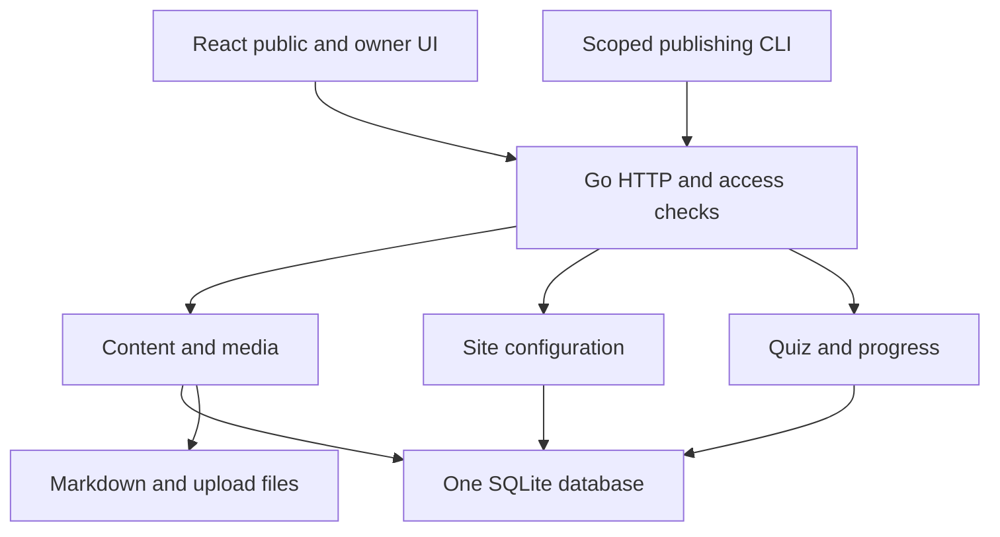

# Configuration and learning contracts

[العربية](architecture-appendix-configurable-learning.ar.md) · [Architecture](architecture.md)

Detailed constraints for settings, learning access, authentication, and persistent storage.

## 1. One application with clear responsibilities

These are packages inside the same Go process, not separate services.

| Area | Go responsibility | React responsibility |
| --- | --- | --- |
| `internal/auth` | Owner bootstrap, passkeys/TOTP, sessions, CSRF, throttling, token scopes | Sign-in, browser WebAuthn ceremony, factor setup, security/session controls |
| `internal/siteconfig` | Settings/profile/labels, validation, apply/history, safe public projection | Branding/profile/label forms and previews using design-system tokens |
| `internal/content` | Existing Markdown revisions, locale review, publication, taxonomy, collections | Public writing/docs, editor, revision comparison and publication controls |
| `internal/learning` | Quiz definitions/grading, path gates, anonymous progress, access decisions | Quiz builder/player, locked page, outline, progress and retry feedback |
| `internal/media` and storage | Durable uploads, purpose limits, controlled reads, reference tracking | Upload queue, picker, previews, alt text/captions, media library |
| `internal/http` and database | Shared routing, request/response schemas, HTML shell, SQL transactions | Typed API client, route layouts, loading/errors, local form state |

HTTP handlers and the publisher call the same application services. Only Go reads
SQLite or managed files. Avoid coupling domain rules to a React component or a
specific brand. Public and owner React route groups share presentation components;
the owner bundle can be lazy-loaded, but bundling is never an authorization layer.

The access service is shared by page resolution, content APIs, media GET/HEAD/
Range, quiz reads, feeds and search projections. A second API route must not
provide a shortcut around a lesson gate.

## 2. Configuration: fields, saving, and multilingual behavior

### 2.1 Three distinct kinds of configuration

| Kind | Lives in | Examples |
| --- | --- | --- |
| Operator configuration | Runtime environment or mounted secret/config files | Base URL, trusted proxy list, data root, WebAuthn RP ID/origins, encryption key, upload limits, backup destination |
| Owner-editable public configuration | Versioned SQLite records; media bytes remain files | Colours, logo, name, photo, hero/banner, experience, links, Now, interface labels, menu/icon choices |
| Reader preference | Browser preference; progress additionally has a server record | Light/dark/system appearance, UI locale; opaque progress cookie |

Never expose operator secrets through the public site payload, frontend build,
settings export, logs, or rendered style tags. Runtime branding updates need no
Webpack rebuild, server restart, or edit to the source token file.

### 2.2 Branding and identity

Store `logo_mode` (`wordmark`, `monogram`, `image`), bounded wordmark text,
one-to-three-grapheme monogram, optional logo and favicon media IDs, menu icon
choices, and primary/secondary hex colours. Store the portrait separately from
the logo so a person can use a photo and a wordmark together. An absent portrait
uses the monogram; an absent image logo uses the wordmark/monogram. Keep one
header identity control; an author photo within article content is not another
header menu.

Logo/favicon: verified PNG/JPEG/WebP, at most 1 MiB. Portrait: the same formats,
at most 2 MiB, square and at least 600 × 600 pixels. Optional home banner: a
validated raster image within the ordinary 10 MiB image limit, with localized
alt text and a crop/focal-point setting. Reject excessive decoded pixel counts
as well as byte-size violations. File-purpose checks run again when settings
reference an existing media ID. No uploaded CSS, fonts, JavaScript or SVG.

`design-system/tokens.json` remains the source of **shipped defaults**. Generate
`tokens.css` with `node design-system/scripts/build-tokens.mjs`; do not edit the
generated file. Saved installation colours override only the allowlisted
`majorelle*`, `on-majorelle`, `sun`, `on-sun` and dependent shadow variables.
Neutral, status, spacing and typography tokens stay under code control.

Use the derivation rules in BRAND.md, with a versioned deterministic algorithm
and shared Go/TypeScript test vectors. Validate canonical `#RRGGBB` inputs;
derive light/dark shades and foregrounds, then check actual pairs on paper,
surface, soft fills, primary/secondary fills and focus boundaries. Require 4.5:1
for ordinary text and 3:1 for applicable large text/control boundaries. Explain
adjusted shades in the preview; block applying a palette if required pairs still
fail. Do not trust ratios sent by the browser.

Go emits validated numeric/hex overrides in the initial document shell using a
CSP nonce, with an allowlisted theme script if needed to avoid a theme flash.
Do not concatenate owner input into arbitrary CSS. The saved public response
contains the palette algorithm version and effective theme values; the owner
preview uses the same contract. The reader can still choose light/dark/system.

### 2.3 Profile, home header, banner, and experience

| Field group | Data and validation |
| --- | --- |
| Identity and header | Localized display name, headline (newlines and limited emphasis), short bio up to 320 Unicode characters, optional sticker text, localized photo/banner alt text |
| Header actions | One main action plus up to ten ordered links with stable IDs, localized labels, address, allowlisted icon and visibility. GitHub/LinkedIn are optional, never guessed. |
| Now | Up to three stable rows, each with localized label and text up to 160 characters; `updated_month` is `YYYY-MM`, localized for display; hide empty rows |
| Experience | Up to twenty ordered entries: stable ID, localized role/organization/short description, start/end year-month, current-role flag, optional validated URL |
| About | Short structured profile text; optional longer narrative references a localized `doc` item whose body follows the existing Markdown-file revision workflow |
| Contact/footer | Public email, optional location string, copyright/display name, social links, localized footer invitation. Login email is private and managed separately. |
| Home composition | Fixed Version B sections, with visibility for optional banner, Now, writing and learning; bounded item counts. This is not a free-form page builder. |

Headline emphasis and bio bold are a small, inert formatting grammar; store
bounded structured text, not executable HTML. Longer prose belongs in Markdown
files. Links accept `https:`, constrained `mailto:` and local absolute paths;
reject protocol-relative links, credentials in URLs, unsafe schemes and control
characters. Do not fetch arbitrary link targets or remote avatars server-side.

An About document selected for the profile must be published in the displayed
locale before public use; its editorial-only role can exclude it from the writing
archive without bypassing normal access checks. Empty experience/contact fields
are hidden. The optional banner defaults to off and must not obscure hero text.

### 2.4 Interface labels are separate from article translations

Each code-owned label has a stable key, section, default EN/FR/AR values, allowed
placeholders and usage description. React resolves **every** visible interface
string through this registry, including accessible names, errors, empty states,
quiz results and admin controls. Go returns machine error codes and typed
parameters; it does not depend on customized prose for business rules.

The Labels editor starts from shipped values, with installation overrides layered
on top. An explicitly empty FR/AR override means fallback to the effective English
value and is counted as missing; Reset restores the shipped locale value. Keys
without an override use their shipped locale default, then English. Core English
labels cannot be blank; custom keys require an English value. Fallback text is
marked with its actual language/direction when embedded in another locale.

Keys match a bounded lowercase `section.name` form with dots/hyphens. Core keys
cannot be renamed or deleted through the dashboard. Adding a custom key stores
text for a supported configured slot or later code use; it does not change routes
or add new controls. Escape text; reject HTML and unknown placeholders. For counts,
the registry declares supported plural forms and typed interpolation parameters;
use locale-aware plural selection, including Arabic, rather than concatenated
English fragments. Preserve the required placeholder set on translation/import.

Search, section filter, missing-only, missing counts, reset-to-default and an
owner-only JSON export/import use the same versioned label bundle. Import validates
the schema and key count/length before saving. No code execution or new dependency
installation is possible through a label.

Profile fields and interface labels may visibly fall back to English. **Articles,
lessons, docs, and quizzes do not silently become English content under an Arabic
or French identity.** Offer an explicit available-language link. Locale choice
never changes authorization or grants progress. EN/FR use LTR; AR uses RTL with
code/identifiers isolated. French is a full production locale.

### 2.5 Preview, review, apply, and history

Settings, Profile and Labels each have their own versioned configuration document.
The UI edits a local working copy; preview and Cancel do not change public data.
**Save and apply** submits a validated snapshot and `expected_version`. Go checks
all fields and media, records an immutable configuration revision, and advances
the current pointer in one transaction. A 409 keeps the unsaved form intact.
There is no separate hidden “publish settings” step.

For changed translated profile/label fields, Save and apply includes explicit
review confirmation for those values; the server records the snapshot, source
hash, locale and reviewer. Existing reviewed values remain live if the owner
has not finished a new translation. Automation imports translations as reviewable
drafts for articles under the existing content API; it cannot write or apply site
configuration. For profile/labels, the owner can import prepared translation data
into a working copy, review it and apply it. This review is a product workflow, not a
request to reapprove the architecture.

Restore copies an earlier configuration snapshot into a new working revision;
applying it is explicit. Referenced media in retained snapshots cannot be deleted.
Public reads expose only the applied version and its safe projection. Invalidate
affected React queries after success; new public requests see applied changes.
No cross-tab live-update service is required.

## 3. Learning identity, quizzes, and locked lessons

### 3.1 Keep reader progress without public registration

The first implementation uses an anonymous learning identity, created only when
the reader starts a path or submits a quiz. Go issues a cryptographically random
opaque token in a separate `__Host-learning` Secure, HttpOnly, SameSite=Lax cookie;
SQLite stores its hash, identity ID, expiry and progress. It conveys **no owner
permissions**. Cookie-based progress mutations require origin/CSRF checks too.

Tell readers: “Progress is saved in this browser.” Clearing cookies or switching
devices loses access to that progress; no email, login, fingerprinting, cross-device
sync or account recovery is implied. Provide Reset learning progress, with clear
confirmation, that invalidates the token and deletes its progress. Initial idle
retention is 180 days, adjustable by the operator and described in the privacy
notice; an expiry resets access to the initial lessons.

Owner previews use a distinct preview mode and never create learner passes.
Owners can use the ordinary reader flow to test progression. Cross-device learner
accounts would be a separate explicit extension; they are unnecessary for this
personal blog's initial learning flow.

### 3.2 Quiz data and grading

Any article or lesson can have a quiz. Only a lesson in an ordered learning path
can make passing a prerequisite. The same editor/player serves both. Quiz content
is bounded structured assessment data in SQLite, not a second copy of an article
body. Export/import includes it in validated frontmatter or a structured sidecar;
Markdown bodies and uploads remain normal files.

- Initially 1–20 questions, with single choice, multiple choice, or true/false;
  choice questions have 2–8 options. Require prompt and option text, unique stable
  IDs, exactly one correct answer for single/true-false, and at least one for
  multiple choice. True/false has exactly two fixed semantic options.
- Each question is worth one point. Multiple choice is correct only when the
  selected option set exactly matches the answer set; no partial credit.
  The integer pass mark is 1 through the number of questions.
- Prompts, option labels and explanations are localized plain text with bounded
  lengths. Answers are option IDs, not labels or array positions. Reject missing,
  duplicate, unknown, or wrongly shaped answers before grading.
- Unlimited retries remain the learning policy. Rate limits protect the service;
  they do not impose a lifetime attempt cap. Explanations can be enabled/disabled;
  score and per-question outcome are still available after a complete submission.
- Public quiz responses omit answer keys and explanations that could reveal them
  before submission. Correct options/explanations may be returned after grading,
  matching the teaching design. These are practice quizzes, not proctored exams
  or certificates, and shared answers cannot be prevented.

An attempt request contains the quiz version, content revision, path version and
answers, plus an idempotency key. Go verifies the learning identity, current
publication, prerequisites and version. It grades against the stored answer key,
then inserts the attempt and any completion record in one short transaction.
The response contains score, pass mark, feedback, completion and the currently
available next action. The client never submits a trusted `passed` or `unlocked`
boolean. Replaying the same request returns the same result; another payload
under the same key is a conflict. A stale quiz/path gets 409 with a reload action,
not grading against unseen new questions.

### 3.3 Publication, translation, and quiz versions

A content draft references an immutable quiz definition/version and localized
question text. Publishing that content revision publishes its quiz binding too;
saving a draft does not change a live quiz. Owner preview grades a saved draft
through a preview endpoint without writing attempts or progression.

Canonical question/option IDs, grading keys and pass mark define one assessment
version across languages. A translation supplies localized wording and review
against that exact version; it cannot quietly change the correct answer or lower
the threshold. Publishing a revised canonical assessment may leave older article
translations live, but their outdated quizzes cannot grant new passes: show an
explicit link to an available current quiz language until reviewed translations
are published. Text-only article edits can reuse the existing assessment version.
An assessment used by a gate needs an owner review recorded for its exact version
before activation; scoped automated publication cannot substitute a new unreviewed
assessment even when its numeric pass mark is unchanged.

Previously earned passes remain valid by default, even after question corrections
or reordering. Store the exact assessment version as evidence. A path has a
`progress_epoch`, initially 1. If the owner intentionally needs everyone to repeat
material, a separate Reset path progress action increments that epoch after
showing its impact. Neither an ordinary edit nor a publishing token can reset
learner achievements silently.

### 3.4 Ordered prerequisite rules

Paths remain simple ordered lists, not an arbitrary dependency graph. The Quiz
builder's “Passing unlocks the next lesson” updates a draft gate in the path's
publication plan. The gate requires a valid published quiz in its source lesson.
Publishing the lesson and the matching path rule checks both expected versions
and commits together. A future next lesson inherits the gate at that boundary.

To open lesson N, all quiz gates on earlier path boundaries must be satisfied for
the reader and current epoch. This prevents skipping a gate by directly opening
lesson N+1 when N itself has no quiz. A boundary without a quiz gate adds no
prerequisite. Gates refer to stable source lesson IDs, never URL text or position
alone. All locales share the same progression rules and achievements.

| State | Public result | What changes it |
| --- | --- | --- |
| Open | Published body, authorized media, quiz if present | Publication exists and preceding gates are satisfied |
| Locked | Published title/summary/optional explicit teaser, reason and first unmet prerequisite; no protected body | Passing required quizzes, or owner explicitly removing a gate |
| Soon | Optional owner-published roadmap title/position only; no content link/body | Publishing the relevant locale; it may then still be Locked |
| Hidden | No public entry, title, count or content route | Explicit announcement or publication |

Completion and access are different. A quiz lesson is complete after a pass. A
non-quiz lesson has a Mark as read action available only when its body is open.
Opening a page or scrolling is not proof of understanding. “3 of 6 complete”
counts completion records; “4 published” is a separate collection statistic.

Unpublishing a prerequisite cannot accidentally unlock later lessons. If a
required quiz is unavailable, existing valid passes continue to count; new
readers see an unavailable-prerequisite state and an available-language option
where possible. The owner sees the affected path before applying the change.
Reorder validation prevents self-dependencies, invalid positions and a gate whose
source no longer precedes its targets; it shows newly affected lessons before
committing. Deleting quiz data referenced by a live gate is rejected until that
gate is explicitly removed or replaced. Previously read material cannot be
retracted from a reader's device.

### 3.5 Enforce access on every delivery path

The normal public content endpoint returns 403 `lesson_locked` with a safe teaser
payload for an unsatisfied published lesson. The HTML route returns the locked
screen with the same status, safe metadata and `noindex`; missing/unpublished
content remains 404. Readable content uses the normal 200 response. Explicit
roadmap metadata is separate from any unpublished content response.

Do not put the full lesson in the DOM, JSON, source map, hidden preview, search
result, RSS body, social metadata, prefetch or export. Exclude gated body pages
from the initial sitemap; feeds/search may link to their public summaries marked
as locked. Never silently prefetch a protected next lesson. No public endpoint
exports quiz answer keys or private revision history.

Media authorization becomes: owner access, or a public profile/teaser reference,
or at least one currently published content reference the reader may access.
Apply that rule to images, video GET/HEAD/Range, captions, posters, transcripts
and downloads. A file deliberately reused in an open article is public through
that article; show this usage in the owner media library so it is not mistaken
for private lesson material. Gated-only media stays protected even if its ID is
known. No direct reverse-proxy static alias to the upload directory.

Use `Cache-Control: no-store` on personalized content, progress, attempts, auth,
and controlled media, consistent with the baseline. Bound request sizes, quiz
submissions and identity creation; store minimal progress and expire inactive
identities/attempts. A suggested initial quiz limit is 10 submissions/minute per
identity with an additional IP ceiling; tune for shared networks. Rotate/cap
abuse records and audit data so anonymous traffic cannot grow SQLite indefinitely.

## 4. Owner authentication and recovery

### 4.1 Recommended login

Use **passkeys through WebAuthn, with user verification required**, as the preferred
owner login. Device PIN/biometric verification unlocks the credential locally;
the server receives a signed challenge, not biometric data. Unlike typed OTPs,
WebAuthn binds authentication to the configured relying party and origin. See
[W3C WebAuthn](https://www.w3.org/TR/webauthn-3/) and
[OWASP MFA guidance](https://cheatsheetseries.owasp.org/cheatsheets/Multifactor_Authentication_Cheat_Sheet.html).

Support the reference's **password + authenticator TOTP** as an optional
compatibility method, enabled only after complete enrollment. It is stronger
than password-only login but not phishing-resistant. Keep it disabled if the
installation chooses passkey-only operation. Do not use SMS or emailed codes
as the default, and do not require an email delivery provider for self-hosting.

### 4.2 Setup and credential lifecycle

Create the single owner with a local administrative command, never an open
registration route. Setup creates a short-lived, single-use bootstrap grant and
a restricted enrollment session. Enter the grant in a form, not a URL; do not log
it or bake it into the image. The owner gets dashboard access only after setting
up a verified passkey or password plus verified TOTP. Disable bootstrap after
completion; a public deployment must fail closed if setup is incomplete.

Offer a second passkey/security key and generate ten high-entropy recovery codes
(at least 128 random bits each), shown once for offline storage. The demo's short
`ABCD-1234` is not the production format. Store only recovery-code hashes. Consume
a code transactionally so simultaneous requests cannot reuse it.

In password/TOTP mode a recovery code replaces TOTP only after password
verification. In passkey-only mode a recovery code grants a restricted, expiring
re-enrollment session, not publishing access. After successful replacement,
revoke existing owner sessions and require a fresh complete sign-in. Recovery
events are prominent in the security log. If all factors/codes are lost, an
operator with VPS access can use the local recovery command; there is no public
“disable MFA” endpoint. That command invalidates outstanding challenges and
sessions, starts restricted enrollment, and records the operation.

Outside the restricted bootstrap/recovery ceremonies, adding/removing a factor,
changing the password/login email, regenerating recovery
codes, creating publisher tokens or resetting authentication requires recent full
reauthentication (initial freshness window: five minutes). Prevent removal of the
last usable login method. Disablement/recovery revokes relevant sessions, and
replacing an OTP seed invalidates the old seed. Show device names, creation/last
use times and revoke actions without logging secrets. A future optional email
notification does not become a recovery authority.

### 4.3 Server safeguards and sessions

Use maintained Go implementations for WebAuthn, TOTP and password hashing; do not
write cryptography. Specific libraries/versions are chosen and checked during
implementation, not inherited from the legacy repository.

| Concern | Required behavior |
| --- | --- |
| WebAuthn | Use discoverable credentials for sign-in without typing an account name, with an opaque owner user handle. Verify challenge, ceremony type, exact origin/RP ID, signature, credential/owner association, user presence and verification. One-use challenges expire after five minutes and are bound to the ceremony/session. Store credential ID/public key and library-managed counter/backup metadata. Require verification at registration as well as login; handle synced passkey counters using the library's rules. |
| Passwords | Salted Argon2id with versioned parameters, benchmarked for the VPS; no plaintext, encryption-as-password-storage, truncation, or home-grown hashing. See [OWASP password storage](https://cheatsheetseries.owasp.org/cheatsheets/Password_Storage_Cheat_Sheet.html). |
| TOTP | Six digits, 30-second steps, small documented clock-skew tolerance; atomically reject replay of an already accepted time step. Pending password authentication has no owner privileges and expires after five minutes. |
| OTP secret | Encrypt the seed with an authenticated cipher under an operator-held key outside SQLite; a hash cannot verify future TOTP codes. QR/seed is available only during enrollment, with no-store and no logs. Back up the encryption key separately and securely. |
| Throttling | Account and trusted-client-IP limits cover password, TOTP, passkey completion, bootstrap and recovery. Five failed attempts cause a bounded 15-minute pause initially; unknown/wrong accounts get equivalent errors. Use progressive/IP limits before a global owner lock to reduce denial-of-service risk; counters cannot reset by changing a challenge. |
| Session | Random opaque server-side session, hashed token in SQLite; `__Host-owner` Secure, HttpOnly, SameSite=Strict, Path=/, no Domain. Rotate on authentication; initial 30-minute idle and 12-hour absolute expiry. No JWT/publisher token in localStorage. |
| Browser writes | CSRF token and origin checks, including logout/factor/settings operations; no state changes on GET. SameSite alone is insufficient. See [OWASP session management](https://cheatsheetseries.owasp.org/cheatsheets/Session_Management_Cheat_Sheet.html). |
| Proxy and deployment | HTTPS in production; explicit base URL, RP ID and origin allowlist; trust forwarding headers only from configured proxy addresses. A domain change needs an enrollment/recovery migration, not silently accepting arbitrary origins. |
| Audit | Record security/configuration/publication outcomes and request IDs; never password, QR seed, OTP, raw token, recovery code, answer payload or private Markdown body. |

Password verification alone returns a restricted pending challenge, **not** the
normal session cookie. `POST /api/v1/session` retains the password entry point but
no longer completes sign-in by itself. Sign-out revokes the current full session;
Security also supports revoke all sessions. Publisher tokens are separate machine
credentials: revocable, scope-limited, never valid for owner login, settings,
factor changes or learner impersonation.

### 4.4 New computers and independent backup / الأجهزة الجديدة والنسخ الاحتياطية المستقلة

The accepted [new-device and recovery guide](passkey-access.md) is part of this
contract. Support multiple registered credentials and standard WebAuthn phone or
security-key flows where supported; do not constrain enrollment to a built-in
authenticator. A synced credential may become available through its provider, or
the phone can authenticate a new computer without copying its private key.
Synced copies of one credential are not independent backups. Offer a separately
registered backup and offline recovery codes, then restricted VPS recovery if
necessary. Test new-device enrollment and loss/recovery, not only the happy path.

يُعد [دليل الأجهزة الجديدة والاسترداد](passkey-access.ar.md) جزءاً من هذا العقد.
ادعم عدة مفاتيح مسجلة وتدفقات WebAuthn القياسية بالهاتف أو مفتاح أمان حيث تتوفر،
ولا تحصر التسجيل في أداة توثيق مدمجة بالجهاز. قد يتاح المفتاح المتزامن عبر مزوده،
أو يوثّق الهاتف جهازاً جديداً دون نسخ مفتاحه الخاص إليه. النسخ المتزامنة للمفتاح
نفسه ليست نسخاً احتياطية مستقلة. وفّر تسجيلاً لمفتاح احتياطي مستقل ورموز استرداد
محفوظة دون اتصال، ثم استرداداً محدوداً عبر VPS عند الحاجة. اختبر التسجيل من جهاز
جديد وفقدان الوسائل واستردادها، وليس الدخول الناجح المعتاد فقط.

## 5. SQLite additions and file boundaries

These are logical records to turn into SQL migrations; table consolidation is
allowed where it preserves the constraints. No database implementation is claimed.

| Records | Essential fields/constraints |
| --- | --- |
| Configuration documents/revisions | Kind (`site`, `profile`, `labels`), version, applied revision, immutable bounded JSON snapshot, schema/colour-algorithm version, actor/time. Localized profile/label values and translation review hashes belong to that snapshot. Replaces, rather than duplicates, the earlier settings authority. |
| Configuration media references | Configuration revision + media ID + role; foreign keys preserve retained history and drive current public visibility. |
| Label registry | Code-owned keys/defaults/placeholder schema; SQLite stores overrides/custom keys only. Imports are versioned and validated. |
| Quiz definitions/versions | Stable quiz and item IDs; immutable version with question/option IDs, answer keys, pass mark, feedback policy. Definition belongs to one content item. |
| Quiz localizations/bindings | Content revision + quiz version + locale; localized prompts/options/explanations and review reference. One binding per content revision; public projection excludes answers. |
| Assessment reviews | Exact canonical quiz version, owner ID and review time; required before activating that assessment for a path gate. |
| Path plans/gates | Versioned ordered members, gate source lesson/assessment policy, active plan pointer, epoch; unique membership/position. Draft plan changes never affect live rules. |
| Roadmap teasers | Explicit public title/summary/position per locale, optional linked item ID; no automatic publication of draft metadata. |
| Learning identities | ID, unique opaque-token hash, created/last-active/expiry timestamps; no personal account fields. |
| Quiz attempts | Identity, item, content/quiz/path versions, epoch, score/total/pass, bounded feedback, idempotency/request hash and timestamp. Do not keep raw selected-answer payloads beyond what the feedback contract requires. |
| Completion | Unique identity + path + lesson + epoch, completion method (`quiz_pass`, `read`), evidence attempt/version and time. Failed attempts do not erase an earned pass. |
| Owner credentials | Existing singleton owner plus multiple passkey public credentials; optional password hash and encrypted TOTP seed, accepted TOTP step, factor state/version. |
| Authentication challenges/recovery | Purpose, hashed opaque session/grant ID, challenge bytes/state, expiry, consumed time, failed attempts; recovery-code hashes with one-use state. |
| Sessions, API tokens, audit | Existing server-side session/token records extended with authentication method/time, expiry/revocation, scope; bounded audit entries and throttle state. |

Quiz text/settings are small structured data, so SQLite is appropriate for them.
Article/lesson/doc/About bodies remain `.md` files; image/video/PDF/caption bytes
remain files. Relative generated paths, durable-write-before-DB-commit, checksums,
immutable revisions and coordinated backup rules all remain in effect.

Enable foreign keys, unique indexes and short transactions. An attempt/pass and
its idempotency result commit together. Publication/path-rule updates and
configuration apply operations recheck expected versions inside their transaction.
Use UTC instants and locale-aware date formatting; displayed months/year-month
experience values are not fake midnight timestamps.

## 6. API extensions and permissions

Keep `/api/v1` and the existing content/media endpoints. Paths below specify the
new contract surface; actual OpenAPI schemas are an implementation deliverable.
Opaque IDs, bounded pagination, structured errors and no filesystem paths apply
throughout. Owner cookie writes require CSRF; publisher operations require scopes.

| API | Caller and purpose |
| --- | --- |
| `GET /public/site?locale=…`, `GET /public/labels?locale=…` | Under `/api/v1`; applied safe configuration/labels only. Public site payload includes effective colours, locale/fallback metadata and profile. |
| Existing public content/collections/search | Resolve access consistently; safe locked/roadmap projections as described above. Shared lists may use a separate progress fetch to avoid treating personal counts as public cacheable data. |
| `GET/PUT /settings`, `/profile`, `/labels` | Owner-only versioned read/apply; import/export and history/restore subroutes. Existing `/settings` now covers branding/site settings, not a second profile store. |
| `POST /settings/preview` | Owner-only validation and derived palette/contrast response; no persistence/public visibility. |
| `POST /learning/session` | Create a bounded anonymous progress identity; GET visits alone do not create rows. |
| `GET/DELETE /learning/progress` | Read/reset only the current identity; never accept an arbitrary identity ID from the browser. |
| `GET /learning/paths/{key}` | Public outline plus current reader access/completion; no-store. |
| `GET /learning/lessons/{key}/{locale}/quiz` | Questions and current version for an accessible published lesson; no answer key. Equivalent content-quiz route handles standalone articles. |
| `POST /learning/quizzes/{version}/attempts` | Grade for the current identity, enforce prerequisites/version, return feedback and progression; idempotent. |
| `POST /learning/lessons/{key}/read` | Record a readable non-quiz lesson complete; cannot bypass any quiz or publication condition. |
| Existing content draft/publish APIs | Include quiz binding, source/review IDs and expected path-plan version when relevant. Owner/scoped publisher uses the same transaction rules. |
| `POST /content/{key}/{locale}/quiz-preview` | Owner-only draft grading without saving learning progress. |
| Existing collection APIs; `POST /collections/{key}/progress-reset` | Owner manages path order, gates, announcements and explicit epoch reset. Reset requires recent reauthentication. |
| `POST /session` then `POST /session/totp` or `/session/recovery` | Optional password flow, pending MFA, then complete-session or restricted recovery enrollment. |
| `POST /auth/passkeys/login/options` and `/verify` | Begin and verify a passkey sign-in; no unrestricted registration. |
| `GET /session`, `DELETE /session` | Current owner authentication state/logout. No session secrets in the JSON. |
| `/security/passkeys`, `/security/totp`, `/security/recovery-codes`, `/security/sessions`, `/security/tokens` | Owner-only lifecycle operations with recent reauthentication for sensitive changes. Registration/enrollment uses purpose-bound challenge endpoints. |

All shortened paths in the table are under `/api/v1`. Use 400 malformed, 401
authentication required, 403 forbidden/locked, 404 unavailable, 409 revision or
idempotency conflict, 413 too large, 422 invalid fields, and 429 with Retry-After.
Locked errors contain only intentional public metadata. Authentication errors
do not reveal whether a login identifier exists.

| Capability | Visitor | Learning cookie | Owner session | Publisher token |
| --- | --- | --- | --- | --- |
| Public pages/summaries | Yes | Yes | Yes | Normal public access |
| Gated lesson body/media | Initial ungated access only | When prerequisites pass | Owner preview; never fake learner progress | Only explicit authorized content-read scope |
| Submit quiz/read progress | Create learning identity first | Own identity only | Use separate preview or learning flow | No |
| Draft/media writes | No | No | Yes | Only configured content/media scope and collection |
| Publish/review | No | No | Yes | Explicit publish scope; translation review remains owner-only |
| Configure site, labels, auth, path gates/reset | No | No | Yes; sensitive actions require reauthentication | No |

An automation client can submit Markdown, media and optional structured quiz drafts using scoped
content/quiz-write permissions. A token that can publish lessons cannot silently
change path gates, reset progress, lower an active pass mark, apply branding, or
manage credentials. Such changes require owner actions. Continue original-language
auto-publication only within the configured scope; translations and new gate
definitions follow review. Notion receives a separate delivery; quiz-interaction
and progression state belong to the blog, not to a synchronized Notion database.

## 7. Reusable open-source installation

One installation serves one owner's site. Reusability means another person can
install the same release, set their domain/branding, and publish their own work.
It does not imply multi-tenancy, organizations, subscriptions, or multiple VPSs
for this installation.

- Keep `backend/cmd/blog`, `backend/cmd/publisher`, `backend/internal/…`,
  `backend/migrations/`, `frontend/`, `ui/`, `design-system/`, `deploy/` and `docs/`
  in this repository. Define API contracts
  independently of either UI implementation; avoid another internal SDK/service
  until needed. Keep optional future integrations behind small Go interfaces.
- يوضع الخادم وأداة النشر و`internal/` والترحيلات داخل `backend/`،
  والواجهة داخل `frontend/` في المستودع نفسه. تبقى `ui/` و`design-system/`
  و`deploy/` و`docs/` مجلدات مساعدة. تُعرَّف عقود API باستقلال عن الواجهة، دون
  إضافة SDK أو خدمة داخلية قبل الحاجة؛ تستخدم التكاملات المستقبلية واجهات Go صغيرة.
- Ship empty content/profile data and neutral installation defaults. Onboarding
  collects the owner's name, URL, logo and contact choices. No installation-specific
  social URL, job, city, email, password, quiz progress or posts in production code.
  Sample fixtures are opt-in test/demo data and isolated from normal setup.
- Ship EN/FR/AR interface defaults, supported fonts and icon allowlist. Keep font
  licenses and dependency notices. Public marketing copy, content copyright and
  the engine's software license are distinct concerns.
- The existing root LICENSE is a legacy 0BSD notice naming Gatsby. Preserve it
  in this documentation change. Before a reusable release, record the intended
  license for the newly authored engine and an accurate provenance/third-party
  notice inventory; do not silently rename that copyright or treat personal
  articles/photos as freely licensed engine code.
- Provide `.env.example` with placeholders, Docker Compose, one data volume,
  pinned toolchains/dependencies, and documented setup/upgrade/backup/restore
  commands. Reject placeholder/default credentials at startup. Public configuration
  is explicitly allowlisted for Webpack; never inject the server environment.
- Document contributor workflow, module boundaries, migrations, API compatibility,
  localization, accessibility checks, security reporting, supported browsers and
  release/update policy. The build must not need private Notion or AI-provider accounts.
- Expose an owner-only portable export: manifest, configuration, label overrides,
  taxonomy, collections, Markdown, quizzes and referenced media. Exclude credentials,
  sessions, learner records, API secrets and private operator settings by default.
  IDs/paths are validated/remapped on import; imported articles are drafts unless
  a separate restore operation explicitly preserves live state.
- Back up all SQLite records and referenced files consistently, including quiz
  definitions, progress and applied/retained configuration. Keep encrypted auth
  keys in a separate protected recovery bundle. Restore into maintenance mode;
  disable restored owner login credentials, sessions, pending challenges, recovery
  codes and API tokens because revocations after the snapshot are unknowable.
  Re-enroll the owner through the local operator command and reissue required
  tokens before reopening owner/publisher access. Invalidate learning cookies
  too. Restoring data must not silently revive a revoked passkey or other credential.
  This deliberately resets anonymous readers' browser access to progress after a
  disaster restore; retained attempt records are not a promise of recoverable
  cross-device identities. Explain that limitation in the recovery runbook.
- Bound/expire failed attempts, progress identities and audit records. Expose a
  small maintenance command and health checks; no queue, Redis, analytics service
  or scheduled AI generation is required inside the blog.
